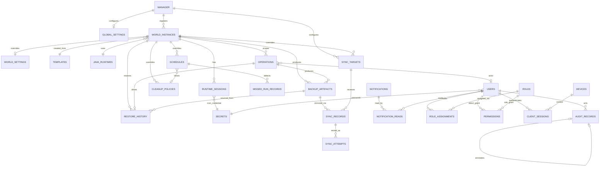

Document 7: Database Schema & Persistence Design (Revision 3 — Product Design Review: ManagerBackup, Generalized Optimistic Locking, Per-World Idle Countdown)

Purpose
- Turns Document 6 (Revision 6)'s domain model into an actual buildable SQLite schema: every table, column, type, key, index, and constraint.
- Closes the Document 9 "Document 7 Expansion" checklist: full ER diagram, every table/column specified, SQLite types, PKs, FKs, indexes, uniqueness, cascade behavior, migration strategy, schema versioning, startup reconciliation, example records, normalization review, performance considerations.
- Everything here is downstream of Document 6 and Document 10 — where this document names a rule (deletion tiers, secrets storage, etc.), it is applying a decision already made there, not making a new one.

0. Conventions (apply to every table below unless stated otherwise)

- **IDs**: `TEXT`, application-generated (UUIDv4 or similar), never auto-increment integers for anything that is referenced across tables or that must be stable across export/import. `INTEGER PRIMARY KEY AUTOINCREMENT` is acceptable only for purely internal, never-externally-referenced rows (none currently — flagged if that changes).
- **Timestamps**: `INTEGER`, Unix epoch seconds. This follows Doc 1 §9 directly ("Timezone <Unix Epoch> — all time related aspects of the app are based on this"), not just SQLite convention.
- **Booleans**: `INTEGER` (0/1).
- **JSON payloads**: `TEXT`, application-validated. SQLite's JSON1 functions may be used for querying where useful, but no column is declared as a native JSON type (SQLite has none).
- **Deletion marker**: exactly one column, `deleted_at INTEGER NULL`, used identically everywhere a Tier 2 entity (per Doc 6's Global Deletion & Retention Model) is soft-removed. `NULL` = active/live. A non-null value is the only "deleted" signal anywhere in this schema — there is no second column, no status-enum substitute, for this purpose.
- **Deletion actor**: `deleted_by TEXT NULL`, a `user_id` (or `'system'` for automated actions), present on every table that has `deleted_at`.
- **Tier 1 tables** (`audit_records`, `notifications`, `notification_reads`, `missed_run_records`, `sync_records`, `sync_attempts`) never have a `deleted_at` column at all — there is nothing to mark, since nothing ever removes them.
- **FK enforcement is the deletability boundary**: every foreign key in this schema is declared `ON DELETE RESTRICT` unless stated otherwise. If a table needs to permanently outlive whatever it originally pointed to, it does not use an enforced FK for that reference — it stores the ID as a plain value plus a denormalized snapshot of the identifying fields at write time, per Document 6's snapshot pattern (`audit_records.device_id_snapshot`, `missed_run_records.schedule_name_snapshot`, `runtime_sessions.launch_args_snapshot`). This is deliberate: it means Cleanup's hard-delete eligibility check for any Tier 2 row is exactly "does anything still hold an enforced FK to me" — no separate bookkeeping needed.
- **No table anywhere issues `ON DELETE CASCADE`.** Per Doc 6's Global Deletion & Retention Model, nothing but the Cleanup subsystem ever performs a physical delete, and Cleanup always checks dependents explicitly rather than relying on cascading SQL to do it silently.

1. Full Table List

Manager/global: `manager`, `global_settings`, `schema_migrations`
World/registry: `world_instances`, `world_settings`, `templates`, `java_runtimes`
Runtime: `runtime_sessions`, `operations`
Backup/restore/retention: `backup_artifacts`, `restore_history`, `schedules`, `missed_run_records`, `cleanup_policies`
Sync: `sync_targets`, `sync_records`, `sync_attempts`
Notifications/audit: `notifications`, `notification_reads`, `audit_records`
Identity/security: `users`, `roles`, `role_assignments`, `permissions`, `devices`, `client_sessions`, `secrets`

(27 tables total — the original Doc 7 list of 17, plus `missed_run_records`, `notification_reads`, `role_assignments`, and `schema_migrations` from Revision 2, plus `sync_targets`, `sync_records`, and `sync_attempts` from this pass — `sync_attempts` split out from `sync_records` per explicit instruction to preserve full per-attempt retry history.)

2. Table Definitions

2.1 manager (singleton — exactly one row, enforced at application layer)
| Column | Type | Notes |
|---|---|---|
| manager_id | TEXT | PK |
| deployed_version | TEXT | current commit/version reference, Doc 1 §17 |
| setup_completed | INTEGER | |
| created_at | INTEGER | |
| updated_at | INTEGER | |

2.2 global_settings (singleton — one row, defaults inherited by any world without an override in `world_settings`)
| Column | Type | Notes |
|---|---|---|
| settings_id | TEXT | PK |
| timezone | TEXT | IANA name; all scheduling computed in epoch regardless |
| idle_countdown_seconds | INTEGER | |
| notification_defaults | TEXT (JSON) | sounds, message templates, repetition |
| minecraft_root_path | TEXT | |
| backup_root_path | TEXT | |
| log_root_path | TEXT | |
| offsite_sync_defaults | TEXT (JSON) | method + non-secret config; credentials live in `secrets` |
| version | INTEGER | optimistic concurrency, generalized per Document 11 §4 |
| updated_at | INTEGER | |
| updated_by | TEXT | FK -> users.user_id, RESTRICT |

2.3 schema_migrations
| Column | Type | Notes |
|---|---|---|
| version | INTEGER | PK, sequential |
| name | TEXT | |
| applied_at | INTEGER | |

2.4 world_instances (Tier 2 — tombstoned, never hard-deleted in practice per Doc 6)
| Column | Type | Notes |
|---|---|---|
| world_id | TEXT | PK, immutable forever, even past `deleted_at` |
| display_name | TEXT | unique where `deleted_at IS NULL` |
| template_id | TEXT | FK -> templates.template_id, RESTRICT |
| server_type | TEXT | vanilla/forge/fabric/paper/etc |
| mc_version | TEXT | |
| java_runtime_id | TEXT | FK -> java_runtimes.runtime_id, RESTRICT |
| port | INTEGER | unique where `deleted_at IS NULL` |
| addressing_strategy | TEXT | subdomain/port/path, per Doc 2 §1.3 |
| addressing_value | TEXT | the actual subdomain/path assigned |
| state | TEXT | off/queued/starting/running/stopping/restoring/backing_up/crashed/error, per Doc 6 §2.3 |
| pre_backup_state | TEXT NULL | set only while `state = backing_up`, per Doc 6 §2.3 resume-state rule |
| current_operation_id | TEXT NULL | FK -> operations.op_id, RESTRICT — the Operation currently driving a state transition, if any. Cleared to `NULL` by OperationService the moment that Operation reaches a terminal status (Doc 6/Doc 8, decided) — never left pointing at a finished Operation. |
| launch_args | TEXT (JSON) | default startup args for this world. Editable only while `state = off` (Doc 6 §4, Document 11 §5) |
| metadata_version | INTEGER | optimistic concurrency for `display_name`/metadata edits only (`ConfigEdit`/RenameWorld), per Document 11 §4 — distinct from the operational `state` machine, which is never subject to a version check |
| deleted_at | INTEGER NULL | tombstone marker |
| deleted_by | TEXT NULL | |
| created_at | INTEGER | |
| updated_at | INTEGER | |

Indexes: `(state)` for the "list running worlds" homepage query (Doc 5); `(deleted_at)` partial index for "active worlds only" filtering; `(display_name)` to support search/filter once world counts grow beyond a glance-able list (Doc 2 §11.2 "modest home-lab hardware" doesn't preclude dozens-to-hundreds of worlds — see Doc 5's search/filter addition).

2.5 world_settings (per-world override of global_settings; 1:1 with world_instances, only present when a world overrides a default)
| Column | Type | Notes |
|---|---|---|
| world_id | TEXT | PK, FK -> world_instances.world_id, RESTRICT |
| minecraft_root_override | TEXT NULL | |
| backup_root_override | TEXT NULL | |
| log_root_override | TEXT NULL | |
| offsite_sync_override | TEXT (JSON) NULL | |
| idle_countdown_override | INTEGER NULL | seconds; added this revision — closes the one setting that previously had no per-world override despite Schedule/CleanupPolicy/SyncTarget all supporting it (Doc 6 §2.10 three-tier inheritance model) |
| version | INTEGER | optimistic concurrency, generalized per Document 11 §4 |
| updated_at | INTEGER | |
| updated_by | TEXT | FK -> users.user_id, RESTRICT |

Note: `notification_defaults` is deliberately **not** given a per-world override column — this is a considered exclusion (Doc 6 §2.10), not an oversight.

2.6 templates (Tier 2 — soft-deleted/deprecated only, per Doc 6 §2.12)
| Column | Type | Notes |
|---|---|---|
| template_id | TEXT | PK |
| name | TEXT | unique where `deleted_at IS NULL` |
| category | TEXT | free-text, not a closed enum — `vanilla`/`forge`/`fabric`/`paper` are example seed values, not a hardcoded set (closes the "plugin architecture" question from review: adding Quilt/Purpur/NeoForge/Sponge is a new row here, never a code change, provided `config_defaults` below carries enough to launch it — see note) |
| default_version | TEXT | |
| config_defaults | TEXT (JSON) | must include a generic launch-command template (executable pattern, jar/args placeholders) generic enough for the platform adapter to launch *any* category from data alone — this is the actual mechanism that makes new server types data-driven rather than requiring per-type code in the platform adapter layer |
| source | TEXT | built_in / imported |
| deprecated | INTEGER | distinct from `deleted_at` — a deprecated template is hidden from "create new world" but still referenced historically |
| version | INTEGER | optimistic concurrency, generalized per Document 11 §4 |
| deleted_at | INTEGER NULL | |
| deleted_by | TEXT NULL | |
| created_at | INTEGER | |
| updated_at | INTEGER | |

2.7 java_runtimes (Tier 2 — soft-deprecated only, per Doc 6 §2.11)
| Column | Type | Notes |
|---|---|---|
| runtime_id | TEXT | PK |
| label | TEXT | unique where `deleted_at IS NULL` |
| executable_path | TEXT | |
| version_detected | TEXT | |
| status | TEXT | registered/verified/missing/deprecated |
| deleted_at | INTEGER NULL | |
| deleted_by | TEXT NULL | |
| created_at | INTEGER | |
| updated_at | INTEGER | |

2.8 runtime_sessions (Tier 2 in principle, practically permanent — every FK into it or out of it is RESTRICT)
| Column | Type | Notes |
|---|---|---|
| session_id | TEXT | PK |
| world_id | TEXT | FK -> world_instances.world_id, RESTRICT |
| started_at | INTEGER | set only at confirmed `running`, per Doc 6 §2.2 |
| ended_at | INTEGER NULL | |
| end_reason | TEXT NULL | graceful_stop/forced_stop/crashed/emergency_stop/reconciled_missing |
| rcon_secret_id | TEXT | FK -> secrets.secret_id, RESTRICT |
| port_used | INTEGER | |
| java_runtime_id | TEXT | FK -> java_runtimes.runtime_id, RESTRICT — historical, not necessarily the world's *current* runtime |
| launch_args_snapshot | TEXT (JSON) | captured at launch; independent of later `world_instances.launch_args` edits |
| created_at | INTEGER | |

Constraint: partial unique index on `world_id WHERE ended_at IS NULL` — enforces "exactly one open session per world" at the database level, not just in application logic.

2.9 operations (durable command-plane record; immutable except status progression, per Doc 6 unchanged invariant)
| Column | Type | Notes |
|---|---|---|
| op_id | TEXT | PK |
| op_type | TEXT | CreateWorld/Start/Stop/Kill/Backup/Restore/Cleanup/Sync/ConfigEdit/CrashDetected/DeleteWorld |
| world_id | TEXT NULL | FK -> world_instances.world_id, RESTRICT — null for manager-global operations |
| actor_type | TEXT | user / system |
| actor_user_id | TEXT NULL | FK -> users.user_id, RESTRICT — null when actor_type = system |
| idempotency_key | TEXT NULL | |
| status | TEXT | Created/Queued/Validating/Running/Completed/Failed/Cancelled/TimedOut |
| checkpoint | TEXT (JSON) NULL | |
| attempt | INTEGER | |
| compensates_operation_id | TEXT NULL | FK -> operations.op_id, RESTRICT — set only on a compensating Operation (e.g. an automatic restore-revert), per Doc 6 §2.4 |
| intent_at | INTEGER | |
| started_at | INTEGER NULL | |
| finished_at | INTEGER NULL | |
| error_code | TEXT NULL | |
| message | TEXT NULL | |
| data_json | TEXT (JSON) NULL | type-specific payload, including cleanup run summaries (deleted count, freed bytes, errors) — no separate cleanup-run table is needed, since Operations already carry this |
| created_at | INTEGER | |
| updated_at | INTEGER | |

Indexes: `(world_id, status)` for "current world state" queries; `(idempotency_key)` unique where not null, scoped by `op_type`.

2.10 backup_artifacts (Tier 2, created-on-success-only, per Doc 6 §2.5)
| Column | Type | Notes |
|---|---|---|
| artifact_id | TEXT | PK |
| world_id | TEXT NULL | FK -> world_instances.world_id, RESTRICT — **NULL means a ManagerBackup** (manager DB/settings/templates/permissions, not any single world's content), added this revision to close the disaster-recovery gap from review |
| category | TEXT | session_end/manual/scheduled/pre_restore/emergency/manager_config |
| storage_path | TEXT | |
| size_bytes | INTEGER | |
| checksum | TEXT | |
| operation_id | TEXT | FK -> operations.op_id, RESTRICT — the Backup Operation that produced it |
| deleted_at | INTEGER NULL | soft only; file removed from disk, row and metadata retained |
| deleted_by | TEXT NULL | |
| created_at | INTEGER | |

Indexes: `(world_id, category, created_at)` — the exact shape retention rules need to evaluate "keep newest N per category."

2.11 restore_history (Tier 1-adjacent — immutable, append-only outcome record per Doc 2 §4.3; kept as its own table rather than folded into `operations.data_json` because it needs its own structured, queryable fields)
| Column | Type | Notes |
|---|---|---|
| restore_id | TEXT | PK |
| world_id | TEXT | FK -> world_instances.world_id, RESTRICT |
| operation_id | TEXT | FK -> operations.op_id, RESTRICT |
| source_artifact_id | TEXT NULL | FK -> backup_artifacts.artifact_id, RESTRICT — null if source was a raw snapshot path rather than a tracked artifact |
| pre_restore_artifact_id | TEXT | FK -> backup_artifacts.artifact_id, RESTRICT — the mandatory pre-restore backup, Doc 2 §4.3 |
| operator_user_id | TEXT | FK -> users.user_id, RESTRICT |
| outcome | TEXT | success/failed/reverted |
| rollback_of_restore_id | TEXT NULL | FK -> restore_history.restore_id, RESTRICT — self-reference for a corrective restore |
| started_at | INTEGER | |
| finished_at | INTEGER NULL | |
| created_at | INTEGER | |

2.12 schedules (Tier 2, per Doc 6 §2.6)
| Column | Type | Notes |
|---|---|---|
| schedule_id | TEXT | PK |
| scope | TEXT | global / world |
| world_id | TEXT NULL | FK -> world_instances.world_id, RESTRICT — null when scope = global |
| schedule_type | TEXT | backup / cleanup / maintenance |
| interval_spec | TEXT (JSON) | daily/weekly/monthly/every_n_days + parameters |
| time_of_day | TEXT | |
| enabled | INTEGER | |
| version | INTEGER | bumped on every edit, per Doc 6 §2.6 |
| last_changed_by | TEXT | FK -> users.user_id, RESTRICT |
| last_changed_at | INTEGER | |
| deleted_at | INTEGER NULL | |
| deleted_by | TEXT NULL | |
| created_at | INTEGER | |

2.13 missed_run_records (Tier 1 — permanent, no `deleted_at` column exists on this table at all, per Doc 6 §2.6.1)
| Column | Type | Notes |
|---|---|---|
| missed_run_id | TEXT | PK |
| schedule_id | TEXT | plain value, **not an enforced FK** — see snapshot rationale in §0 |
| schedule_name_snapshot | TEXT | captured at detection time |
| schedule_type_snapshot | TEXT | captured at detection time |
| expected_run_at | INTEGER | |
| detected_at | INTEGER | |
| resolution | TEXT | pending / resolved / ignored |
| resolution_at | INTEGER NULL | |
| resolution_by | TEXT NULL | user_id, plain value, not an enforced FK (same reasoning — this row must outlive the referenced user) |
| created_at | INTEGER | |

2.14 cleanup_policies (Tier 2, per Doc 6 §2.7)
| Column | Type | Notes |
|---|---|---|
| policy_id | TEXT | PK |
| scope | TEXT | global / world |
| world_id | TEXT NULL | FK -> world_instances.world_id, RESTRICT |
| age_rule_days | INTEGER | floor of 3, enforced at application layer per Doc 6 §2.7 |
| space_rule_pct | INTEGER NULL | |
| count_rules | TEXT (JSON) | per-category floors (session/manual/pre_restore/emergency), each >= 3 |
| schedule_id | TEXT NULL | FK -> schedules.schedule_id, RESTRICT |
| version | INTEGER | |
| last_changed_by | TEXT | FK -> users.user_id, RESTRICT |
| last_changed_at | INTEGER | |
| deleted_at | INTEGER NULL | |
| deleted_by | TEXT NULL | |
| created_at | INTEGER | |

2.15 notifications (Tier 1 — permanent, per Doc 6 §2.8)
| Column | Type | Notes |
|---|---|---|
| notification_id | TEXT | PK |
| category | TEXT | |
| severity | TEXT | critical/high/normal/informational — expanded from a 3-level draft this revision, per your explicit product decision; drives notification-dropdown prioritization (Doc 5) |
| message | TEXT | |
| related_operation_id | TEXT NULL | FK -> operations.op_id, RESTRICT |
| related_world_id | TEXT NULL | FK -> world_instances.world_id, RESTRICT |
| requires_action | INTEGER | |
| action_taken | TEXT NULL | |
| created_at | INTEGER | |

2.16 notification_reads (Tier 1 — permanent, per Doc 6 §2.8; a consequence of the individual-account decision)
| Column | Type | Notes |
|---|---|---|
| notification_id | TEXT | PK (composite), FK -> notifications.notification_id, RESTRICT |
| user_id | TEXT | PK (composite), FK -> users.user_id, RESTRICT |
| read_at | INTEGER NULL | |
| dismissed_at | INTEGER NULL | added this revision — clears the notification from *this user's* active dropdown view (Doc 5) only; correctly per-user like `read_at`, since a single user dismissing a broadcast notification must not hide it from every other user. The notification row itself is never affected. |

2.17 audit_records (Tier 1 — permanent, append-only, per Doc 6 §2.9)
| Column | Type | Notes |
|---|---|---|
| audit_id | TEXT | PK |
| event_type | TEXT | |
| actor_type | TEXT | user / system |
| actor_user_id | TEXT NULL | plain value, **not an enforced FK** — must survive a soft-deleted User |
| device_id_snapshot | TEXT NULL | plain value, not an enforced FK — captured at write time per Doc 6 §1.1 |
| device_name_snapshot | TEXT NULL | denormalized alongside the ID |
| ip_snapshot | TEXT NULL | |
| operation_id | TEXT NULL | FK -> operations.op_id, RESTRICT |
| world_id | TEXT NULL | FK -> world_instances.world_id, RESTRICT |
| payload | TEXT (JSON) NULL | |
| annotation_of | TEXT NULL | FK -> audit_records.audit_id, RESTRICT — self-reference for corrections/acknowledgements per Doc 6 §2.9 |
| created_at | INTEGER | |

Indexes: `(created_at)`, `(actor_user_id)`, `(world_id)` — audit views need to filter by all three.

2.18 users (Tier 2 — soft-deleted, per Doc 6 §1.1/§2.1)
| Column | Type | Notes |
|---|---|---|
| user_id | TEXT | PK |
| username | TEXT | unique where `deleted_at IS NULL` |
| display_name | TEXT NULL | |
| secret_id | TEXT | FK -> secrets.secret_id, RESTRICT — password hash reference, per Document 10 §2.2 |
| status | TEXT | active/disabled/locked |
| failed_login_count | INTEGER | |
| locked_until | INTEGER NULL | |
| created_by | TEXT NULL | FK -> users.user_id, RESTRICT — self-reference |
| deleted_at | INTEGER NULL | |
| deleted_by | TEXT NULL | |
| created_at | INTEGER | |
| updated_at | INTEGER | |

2.19 roles (Tier 2 for custom roles; the three baseline roles never get `deleted_at` set, enforced at application layer per Doc 6 §2.15)
| Column | Type | Notes |
|---|---|---|
| role_id | TEXT | PK |
| name | TEXT | unique where `deleted_at IS NULL` |
| description | TEXT NULL | |
| is_system_role | INTEGER | true for `Client`, `Admin`, `Superadmin` — renamed this revision per your explicit product decision, supersedes Doc 2 §8.1's tentative "viewer/operator, admin, superadmin" naming |
| version | INTEGER | optimistic concurrency, generalized per Document 11 §4 |
| deleted_at | INTEGER NULL | |
| deleted_by | TEXT NULL | |
| created_at | INTEGER | |
| updated_at | INTEGER | |

2.20 role_assignments (Tier 2, per Doc 6 §2.16)
| Column | Type | Notes |
|---|---|---|
| assignment_id | TEXT | PK |
| user_id | TEXT | FK -> users.user_id, RESTRICT |
| role_id | TEXT | FK -> roles.role_id, RESTRICT |
| granted_at | INTEGER | |
| granted_by | TEXT | FK -> users.user_id, RESTRICT |
| deleted_at | INTEGER NULL | |
| deleted_by | TEXT NULL | |

Constraint: unique `(user_id, role_id)` where `deleted_at IS NULL`.

2.21 permissions (Tier 2, per Doc 6 §2.16)
| Column | Type | Notes |
|---|---|---|
| permission_id | TEXT | PK |
| role_id | TEXT NULL | FK -> roles.role_id, RESTRICT |
| user_id | TEXT NULL | FK -> users.user_id, RESTRICT |
| action_category | TEXT | |
| world_id | TEXT NULL | FK -> world_instances.world_id, RESTRICT — null = global grant |
| granted_at | INTEGER | |
| granted_by | TEXT | FK -> users.user_id, RESTRICT |
| deleted_at | INTEGER NULL | |
| deleted_by | TEXT NULL | |

Constraint (application-enforced, not expressible as a plain SQLite CHECK across nullable columns cleanly, but stated here as a schema-level invariant): exactly one of `role_id` / `user_id` is non-null on any row.

2.22 devices (Tier 2, per Doc 6 §2.13)
| Column | Type | Notes |
|---|---|---|
| device_id | TEXT | PK |
| device_name | TEXT | |
| ip_address | TEXT | |
| owner | TEXT NULL | |
| status | TEXT | unrecognized / registered |
| last_seen_at | INTEGER NULL | |
| deleted_at | INTEGER NULL | "revoked," per Doc 6 §2.13 |
| deleted_by | TEXT NULL | |
| created_at | INTEGER | |
| updated_at | INTEGER | |

2.23 client_sessions (Tier 2, per Doc 6 §2.14)
| Column | Type | Notes |
|---|---|---|
| session_id | TEXT | PK — the session token itself is stored hashed here, not in `secrets`, per Doc 6 §2.14's scope-boundary decision |
| user_id | TEXT | FK -> users.user_id, RESTRICT |
| device_id | TEXT NULL | FK -> devices.device_id, RESTRICT |
| ip_address | TEXT | |
| expires_at | INTEGER | |
| step_up_confirmed_at | INTEGER NULL | |
| last_activity_at | INTEGER | |
| deleted_at | INTEGER NULL | revocation marker, same shared column |
| deleted_by | TEXT NULL | |
| created_at | INTEGER | |

2.24 secrets (server-side only; never exposed to any client-facing query path)
| Column | Type | Notes |
|---|---|---|
| secret_id | TEXT | PK |
| secret_type | TEXT | user_password / rcon_credential / sync_credential / session_signing |
| encrypted_value | TEXT | |
| associated_entity_type | TEXT | user / runtime_session / manager (for sync credentials) |
| associated_entity_id | TEXT | plain value — deliberately not a cross-table enforced FK, since `secrets` is a single shared table serving multiple entity types and a typed union FK isn't expressible cleanly in SQLite |
| rotation_of | TEXT NULL | FK -> secrets.secret_id, RESTRICT — self-reference chaining rotations |
| created_at | INTEGER | |
| rotated_at | INTEGER NULL | |

2.25 sync_targets (Tier 2, per Doc 6 §2.17 — global-default-or-world-override, same shape as schedules/cleanup_policies)
| Column | Type | Notes |
|---|---|---|
| sync_target_id | TEXT | PK |
| scope | TEXT | global / world |
| world_id | TEXT NULL | FK -> world_instances.world_id, RESTRICT — null when scope = global |
| target_type | TEXT | nas / google_drive / other, per Doc 2 §4.4 |
| config | TEXT (JSON) | non-secret connection details (host, path, etc.) |
| secret_id | TEXT | FK -> secrets.secret_id, RESTRICT — credential reference, never the raw credential |
| enabled | INTEGER | |
| version | INTEGER | optimistic concurrency, generalized per Document 11 §4 |
| deleted_at | INTEGER NULL | |
| deleted_by | TEXT NULL | |
| created_at | INTEGER | |
| updated_at | INTEGER | |

2.26 sync_records (Tier 1 — permanent, no `deleted_at` column, per Doc 6 §2.17.1; revised to be a job wrapper over `sync_attempts`, not a single-row-per-try record)
| Column | Type | Notes |
|---|---|---|
| sync_id | TEXT | PK |
| artifact_id | TEXT | FK -> backup_artifacts.artifact_id, RESTRICT |
| sync_target_id | TEXT | FK -> sync_targets.sync_target_id, RESTRICT |
| operation_id | TEXT | FK -> operations.op_id, RESTRICT |
| status | TEXT | pending / succeeded / failed — derived from the most recent `sync_attempts` row for this `sync_id`, never set independently |
| started_at | INTEGER | first attempt's `started_at` |
| finished_at | INTEGER NULL | set only once `status` reaches a terminal value |
| created_at | INTEGER | |

Indexes: `(artifact_id)` — "has this backup been synced" is the primary lookup; `(status)` for surfacing failed syncs in the UI per Doc 2 §4.4's "sync logs and sync failures must be surfaced."

2.27 sync_attempts (Tier 1 — permanent, no `deleted_at` column; the actual retry history, per explicit instruction)
| Column | Type | Notes |
|---|---|---|
| attempt_id | TEXT | PK |
| sync_id | TEXT | FK -> sync_records.sync_id, RESTRICT |
| attempt_number | INTEGER | strictly sequential per `sync_id`, starting at 1, no gaps |
| started_at | INTEGER | |
| finished_at | INTEGER | |
| outcome | TEXT | succeeded / failed_transient / failed_permanent |
| error_message | TEXT NULL | NULL on success |
| created_at | INTEGER | |

Constraint: `UNIQUE(sync_id, attempt_number)` — enforces sequential, gap-free attempt numbering at the database level, not just in application logic.
Indexes: `(sync_id, attempt_number)` — the exact shape a "show retry history for this sync" UI view needs, in order.
Row-level rule: every column on this table is write-once. No application code ever issues an `UPDATE` against `sync_attempts` — a new attempt is always a new row, matching the same append-only pattern already used for `audit_records`.

3. ER Diagram (Mermaid)



4. Constraint & Cascade Summary

- Every FK above is `ON DELETE RESTRICT` except the deliberately-not-enforced snapshot references (`missed_run_records.schedule_id`, `audit_records.actor_user_id`/`device_id_snapshot`, `secrets.associated_entity_id`), which are plain values with no FK constraint at all.
- No `ON DELETE CASCADE` exists anywhere in this schema. World tombstoning, for example, does not cascade at the database level — the application soft-deletes `schedules`/`cleanup_policies` rows for that world explicitly, as its own logged `ConfigEdit` step, per Doc 6's corrected cascade decision.
- Uniqueness is scoped to "live" rows via partial indexes (`WHERE deleted_at IS NULL`) everywhere a name/label/port needs to be reusable after a soft-delete — `world_instances.display_name`, `world_instances.port`, `templates.name`, `java_runtimes.label`, `users.username`, `roles.name`, `role_assignments (user_id, role_id)`.
- **Circular FK note (flagged during project recheck)**: `world_instances.current_operation_id` -> `operations.op_id` and `operations.world_id` -> `world_instances.world_id` are mutual foreign keys between the same two tables, both `RESTRICT`. This is intentional and safe under normal insert ordering (world row created with `current_operation_id = NULL` first, then the Operation row, then `current_operation_id` backfilled), but implementers should be aware SQLite requires either deferred FK enforcement or careful statement ordering when writing the DDL — a naive same-transaction insert of both rows in the wrong order will fail FK checks.
- **`version`-as-optimistic-lock note (decided during project recheck)**: `schedules.version` and `cleanup_policies.version` are not just display counters — ConfigurationService (Doc 8 §1) rejects an edit submitted against a stale `version` rather than silently applying it. No schema-level enforcement is needed for this (it's a compare-then-write check in application code against the current `version` value), but it's worth stating here since the column could otherwise be mistaken for pure audit metadata.

5. Migration Strategy

- `schema_migrations` (§2.3) tracks applied migrations sequentially by integer version.
- Migrations are plain SQL or code-based scripts, applied in order at boot, never out of order.
- Rollback is supported where the migration is structurally reversible (adding a nullable column, adding an index); destructive migrations (dropping/renaming a column with data) require a written up/down pair and a dry-run check against the current row count before applying, consistent with Doc 7 Revision 1's "never silently destroy user data" principle.
- No migration is permitted to hard-delete data from a Tier 1 table. If a Tier 1 table's shape needs to change, the migration adds new columns/tables and backfills; it does not drop and recreate.

6. Startup Reconciliation (ties Doc 3 §7.4 and Doc 6 §2.2 to actual queries)

On manager boot:
1. Load `schema_migrations`, apply any pending migrations.
2. Load all `world_instances` where `deleted_at IS NULL`.
3. Load all `runtime_sessions` where `ended_at IS NULL`.
4. For each open session, probe for a matching live process (platform adapter). If found, leave the session open and set `world_instances.state = running`. If not found, set `ended_at = now`, `end_reason = 'reconciled_missing'`, emit `RuntimeSessionReconciled`, and set `world_instances.state = off` (or `error`, if the world's last known operation didn't reach a terminal status — see next step).
5. Load all `operations` where `status IN ('Queued','Validating','Running')`. For each, re-check world state from step 4; mark `Failed` with `error_code = 'manager_restart_incomplete'` if the operation cannot be resumed, `Completed`/continue if it can be safely inferred as done.
6. Republish current snapshots to any reconnecting clients (Doc 3 §7.4's "republish current snapshots" step) — this is a runtime/service concern, not a schema concern, noted here only for traceability.

7. Example Records

`world_instances`
```
world_id: "w_7f3a...", display_name: "Survival Main", template_id: "t_vanilla",
server_type: "vanilla", mc_version: "1.21.1", java_runtime_id: "jr_21",
port: 25565, addressing_strategy: "port", addressing_value: "25565",
state: "running", pre_backup_state: null, current_operation_id: null,
deleted_at: null, created_at: 1753142400
```

`operations`
```
op_id: "op_9c1e...", op_type: "Backup", world_id: "w_7f3a...",
actor_type: "user", actor_user_id: "u_44a1...", idempotency_key: "backup-w7f3a-20260724",
status: "Completed", attempt: 1, intent_at: 1753142400, started_at: 1753142401,
finished_at: 1753142455, data_json: "{\"artifact_id\":\"ba_88f2\",\"size_bytes\":48213112}"
```

`missed_run_records`
```
missed_run_id: "mr_1120...", schedule_id: "sch_daily_backup_w7f3a",
schedule_name_snapshot: "Daily Backup - Survival Main", schedule_type_snapshot: "backup",
expected_run_at: 1753056000, detected_at: 1753056300,
resolution: "resolved", resolution_at: 1753059900, resolution_by: "u_44a1..."
```

8. Normalization Review

- The schema is in 3NF except for deliberate, justified denormalization: `audit_records.device_id_snapshot`/`device_name_snapshot`, `missed_run_records.schedule_name_snapshot`/`schedule_type_snapshot`, and `runtime_sessions.launch_args_snapshot`. Each exists specifically so a Tier 1/permanent record's meaning doesn't depend on a Tier 2 row that might later change or be soft-deleted — this is the correct tradeoff for historical integrity, not an oversight to "fix" later.
- `global_settings`/`world_settings` split (rather than one settings table with a nullable `world_id`) keeps the "singleton global default" shape distinct from "sparse per-world override" shape, avoiding a table that's mostly-null for every world that doesn't override anything.

9. Performance Considerations

- Indexes listed per-table above target the specific query patterns the product actually needs: active-world lists (Doc 5 homepage), per-world operation history, retention evaluation by category, audit filtering by actor/world/time.
- `operations` and `audit_records` are the two highest-write-volume tables (every state-changing action touches both) — both use `TEXT` IDs with no auto-increment, so write throughput depends on index maintenance cost more than key generation; this is an acceptable tradeoff on the documented reference hardware (Doc 2 §11.1) given the request volumes involved (single-host, trusted-network, not internet-scale).
- `runtime_sessions`' partial unique index (`world_id WHERE ended_at IS NULL`) is the one constraint doing real enforcement work under concurrency — it's what actually prevents two simultaneous "start" requests from ever producing two open sessions for the same world, not just application-level locking.

10. Document 7 Checklist Status

Cross-checking against Document 9's "Document 7 Expansion" list:
- [x] Full ER diagram — §3.
- [x] Every table specified — §2 (27 tables).
- [x] Every column defined — §2.
- [x] SQLite data types — §0, §2.
- [x] Primary keys — §2.
- [x] Foreign keys — §2, §4.
- [x] Indexes — noted per-table in §2, summarized in §9.
- [x] Uniqueness constraints — §2, §4.
- [x] Cascade behaviors — §4.
- [x] Migration strategy — §5.
- [x] Schema versioning — §2.3, §5.
- [x] Startup reconciliation process — §6.
- [x] Example records — §7.
- [x] Normalization review — §8.
- [x] Performance considerations — §9.

Remaining before Document 7 can be marked fully `[x]` in Document 9:
- The `permissions` "exactly one of role_id/user_id" rule is stated as an application-enforced invariant rather than a SQLite `CHECK` constraint — SQLite does support `CHECK`, so this should be written as an actual `CHECK (role_id IS NOT NULL) != (user_id IS NOT NULL)`-style constraint when the DDL is written, not left as prose.
- Doc 6's remaining open value-object typing (flagged in Document 6 Revision 6) should be resolved during actual DDL authoring, since column types here were chosen pragmatically (mostly `TEXT`) without waiting on that finer typing pass.

Addition note: `sync_targets` (§2.25), `sync_records` (§2.26), and `sync_attempts` (§2.27) are added in this pass alongside Document 6 and Document 8, closing the SyncService gap consistently across all three documents in one pass rather than defining the service without its backing schema. `sync_attempts` was split out from `sync_records` per explicit instruction so retry history is a queryable, ordered set of immutable rows rather than a single incrementing counter.

Recheck-pass note: `CreateWorld`/`DeleteWorld` added to `op_type` (§2.9), the `current_operation_id` clearing rule made explicit (§2.4), and the circular-FK and version-optimistic-lock behaviors documented explicitly (§4) — all identified during a full cross-document consistency recheck rather than at original authoring time.

Product-review-pass note (this revision): `backup_artifacts.world_id` made nullable for ManagerBackup; `version` added to `global_settings`, `world_settings`, `templates`, `roles`, `sync_targets`, and `world_instances` (metadata fields only) generalizing optimistic concurrency beyond just `schedules`/`cleanup_policies`; `world_settings.idle_countdown_override` added to complete the three-tier inheritance model (Doc 6 §2.10); `notifications.severity` expanded to four levels; `notification_reads.dismissed_at` added, correctly scoped per-user like `read_at`; `templates.category` documented as free-text/data-driven rather than a closed enum, closing the plugin-architecture question from review. Full context for all of these: Document 6 Revision 7 and Document 11 (new).
