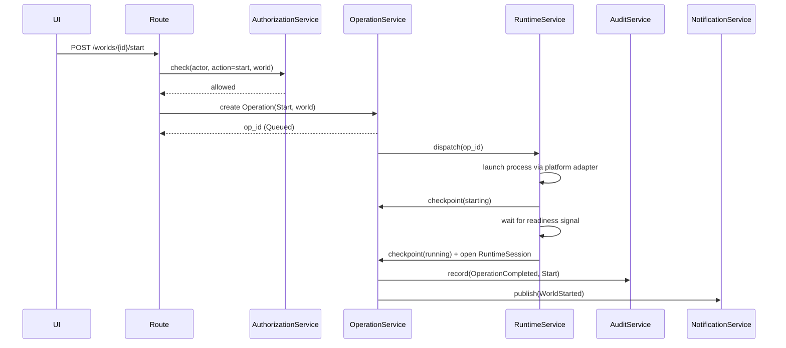
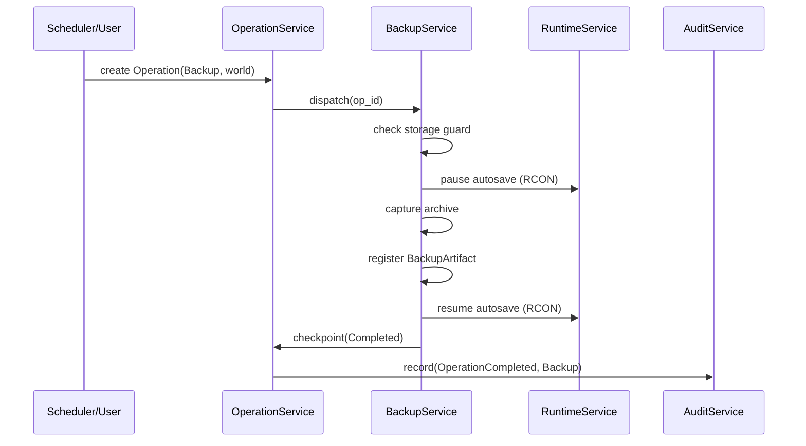
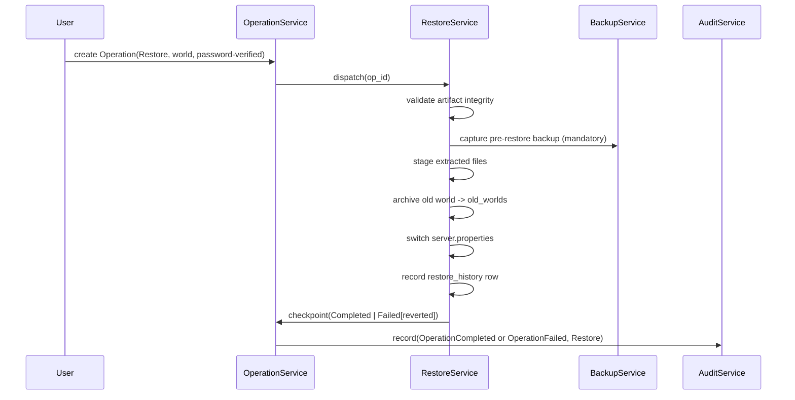
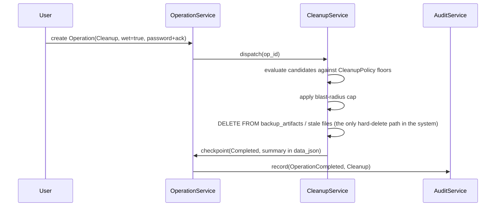
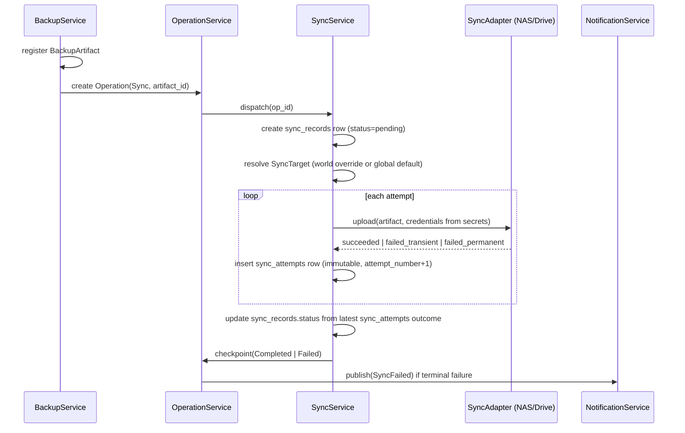
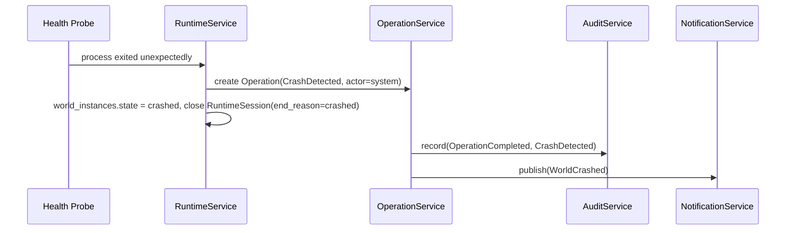
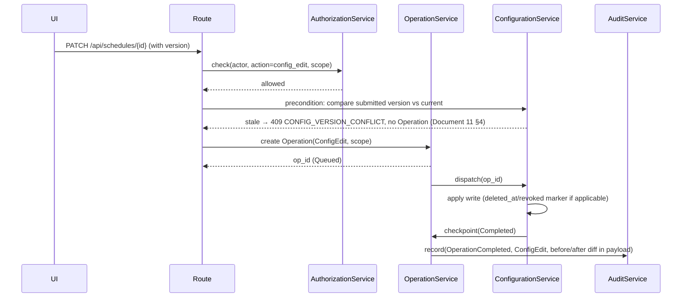
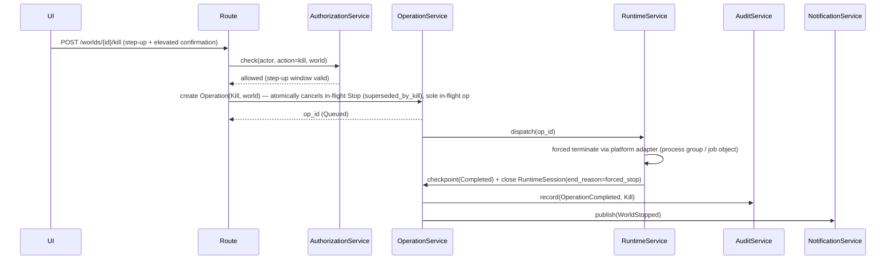
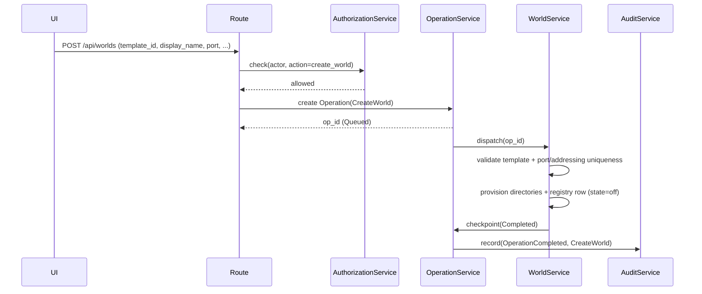
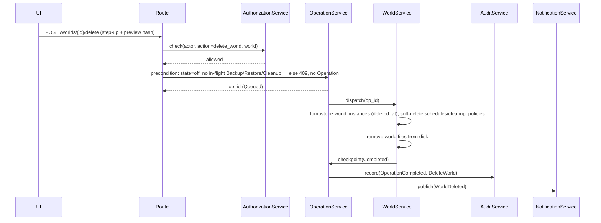

# Document 8: Application Services & Operation Flows

Scope: concrete service behavior derived from Document 6/7 — who does what, in what order,
with what retry/timeout/cancellation/concurrency rules.

## 1. Service Responsibilities & Boundaries

Capability-only matrix (`[X: a,b]` = owns; `Delegates: [X]` = hands off to; `Touches:` =
tables/files). Service = owning service for its operation types unless noted.

| Service | Capabilities | Delegates | Touches |
|---|---|---|---|
| WorldService | [Registry:CRUD, Create:Template, Delete:Tombstone, Rename:Metadata(ConfigEdit), Enforce:ConfigOffOnly] | [Process:Runtime, Data:Backup/Restore/Cleanup] | `world_instances`, `world_settings`, `templates`(R), `java_runtimes`(R) |
| RuntimeService | [Start,Stop,Kill, Session:Open/Close, RCON:RotatePerSession, Health:Probe, Crash:Detect, State:Resolve] | [Operation wrapper:OperationService/Scheduler] | `world_instances`, `runtime_sessions`, `secrets`(RCON only) |
| OperationService | [Op:Create/Status/Checkpoint/Idempotency/Timeout/Cancel, Lock:ReleaseAtTerminal(Document 11 §1.1)] | [Domain action:the owning service] | `operations` |
| BackupService | [Backup:Capture/RegisterArtifact/ResumeAutosave, RCON:NotifyPlayers, Sync:TriggerFollowOn, ManagerBackup(world_id=NULL)] | [When:Scheduler/User, Transfer:SyncService] | `backup_artifacts`, `operations`(checkpoints), `runtime_sessions`(R) |
| RestoreService | [Restore:Validate/PreBackup/Stage/Archive/Switch/RestartIfWasRunning, History:Record] | [PreBackup:BackupService] | `restore_history`, `backup_artifacts`, `world_instances`, `operations` |
| CleanupService | [Retention:Dry/Wet, Delete:HardOnlyPath(any Tier 2 past window)] | — | `backup_artifacts`(file+row), stale world dirs, aged-out soft-deleted Tier 2 rows |
| SyncService | [Sync:Transfer, Records:JobPerArtifact+AttemptPerTry, Retry:TransientBackoff(§6)] | [Target/Creds:ConfigurationService, Backup itself:BackupService] | `sync_records`, `sync_attempts`, `sync_targets`(R), `backup_artifacts`(R), `secrets`(adapter) |
| SchedulerService | [Schedule:Evaluate/Dispatch, Missed:Detect+Record(create only)] | [Work itself:owning service] | `schedules`, `missed_run_records`(create), `operations`(create) |
| AuthenticationService | [Login:User+Pass, Session:Issue/StepUp, Throttle:PassRetry/Lockout] | [Authorize:AuthorizationService] | `users`, `secrets`(password check), `client_sessions`, `devices`(context) |
| AuthorizationService | [Policy:Eval(actor,role,grant,world,state), Roles:Client/Admin/Superadmin, Delegate:SuperadminOnly(Doc 6 §2.16)] | [AuthN:AuthService — assumes valid session] | `roles`, `role_assignments`, `permissions`(R-heavy) |
| NotificationService | [Notify:Publish(4 severities), Reads:LazyPerUser, Serve:DropdownSorted] | — | `notifications`, `notification_reads` |
| AuditService | [Audit:WriteAll(actor/device snapshot at write, Doc 6 §0.1)] | — | `audit_records` (insert-only; no UPDATE/DELETE ever) |
| FileManagerService | [Files:Guarded CRUD, Confirmation:Elevated, Audit:Entry] | — | world filesystem (via adapter), `audit_records`(write) |
| TemplateService / JavaRuntimeService | [Template:CRUD+Deprecate, JavaRuntime:CRUD+Deprecate, Launches:DataDriven(category free-text)] | — | `templates`, `java_runtimes` |
| ConfigurationService | [Config:GuardedEdits(server.properties), ConfigEdit:Orchestrate(never silent), Settings:3-TierInheritance, Version:OptimisticCheck(Document 11 §4)] | [Executing the ops themselves] | `world_instances`(metadata), `world_settings`, `global_settings`, `schedules`, `cleanup_policies`, `roles`, `permissions`, `role_assignments`, `sync_targets`, `templates`(write via logged ConfigEdit) |
| MetricsService | [Metrics:Cadence(null/15s-cache/1Hz), Snapshot:CacheForFirstPaint] | — | none persisted (reads `world_instances`/`runtime_sessions`, broadcasts) |

## 2. Command Flow Per Operation Type

Standard shape for all: authorize -> validate preconditions -> create Operation -> queue ->
dispatch -> execute with checkpoints -> audit -> notify -> terminal status. Differences per
type are preconditions + domain service.

| Operation Type | Preconditions | Domain Service | Terminal Success State |
|---|---|---|---|
| CreateWorld | valid Template, non-conflicting port/addressing, authorization | WorldService | new `world_instances` row, `state = off` |
| Start | world = `off`, storage guard passes, not in 10s cooldown | RuntimeService | `world_instances.state = running`, new `runtime_sessions` row |
| Stop | world != `off`, password verified | RuntimeService | `world_instances.state = off`, `runtime_sessions.ended_at` set |
| Kill | world = `running`/`stopping` (escalation), password step-up + elevated confirmation | RuntimeService | same as Stop, `end_reason = forced_stop` |
| Backup | no backup/restore/cleanup running for this world, storage guard passes | BackupService | new `backup_artifacts` row, world returns to `pre_backup_state` |
| Restore | world = `off`, no backup/cleanup running, valid artifact | RestoreService | `restore_history` row, world back to `off` |
| Cleanup | no backup/restore running for the affected scope | CleanupService | cleanup summary in `operations.data_json`, any row/file removal performed |
| Sync | backup just completed, a `SyncTarget` resolves (override or global default) | SyncService | new `sync_records` row (`succeeded`) |
| ConfigEdit | authorization for the specific config category | ConfigurationService | updated row + `deleted_at`/`revoked` marker if applicable, always with `audit_records` entry |
| CrashDetected | none (system-observed) | RuntimeService | `world_instances.state = crashed`, actor_type = `system` |
| DeleteWorld | world = `off`, no backup/restore/cleanup running, password step-up + elevated confirmation | WorldService | `world_instances.deleted_at` set (tombstoned), files removed from disk |

**"Elevated confirmation"** (used by Kill, DeleteWorld; Stop/Restore's existing password
verification is the same concept): both (1) password step-up (re-entry even for an
authenticated session) and (2) an explicit scope-preview confirmation screen (shows exactly
what will be affected before commit).

## 3. Query Responsibilities

- World list/detail -> WorldService (composes RuntimeService live state + BackupService
  last-backup summary; search-by-name and state/version filtering at query layer, backed by
  the `world_instances (display_name)` index).
- Live metrics -> MetricsService.
- Operation history/status -> OperationService.
- Backup/restore inventory -> BackupService / RestoreService.
- Notifications (unread count, prioritized list) -> NotificationService, joined against
  `notification_reads` for the requesting user, sorted severity then recency.
- Audit/history views -> AuditService.
- Missed-run list -> SchedulerService.
- Device/user/role management views -> AuthenticationService / AuthorizationService.

## 4. Sequence Diagrams

### 4.1 Start

### 4.2 Backup (world running)

### 4.3 Restore

### 4.4 Cleanup (wet run)

### 4.5 Sync (automatic, after backup)

### 4.6 Crash Detection

### 4.7 ConfigEdit

### 4.8 Kill

### 4.9 CreateWorld

### 4.10 DeleteWorld

Flows 4.7–4.10 follow the same structural shape as 4.1–4.6 (authorize → validate
preconditions → create Operation → dispatch → checkpoint → audit → notify); the diagrams
document the type-specific precondition and terminal-success differences.

## 5. Scheduler Behavior

- Evaluate all enabled `schedules` on a fixed tick: **every 30 seconds** (locked tuning
  constant, §6.0).
- Per due schedule: check for a conflicting in-flight Operation for the same scope
  (Document 11); if clear, create+dispatch; if not clear, or the tick was missed (manager
  down/skipped), create a `missed_run_records` row — missed runs are never auto-caught-up.
- A missed run sits `pending` until an operator marks it `resolved` (manually running the
  job) or `ignored`.

## 6. Retry, Timeout, and Cancellation Policy

### 6.0 Locked tuning constants

Locked design constants. Ship as defaults in `global_settings`; globally overridable only
where the table says "configurable" — an override is a plain `global_settings` edit
(ConfigEdit + audit), never a code change. Changing these defaults in the design documents
requires an ARCHITECTURE.md §14 conflict-log entry.

| Constant | Locked value | Notes |
|---|---|---|
| Scheduler tick interval | **30s** | §5; missed-run detection evaluates at tick granularity |
| Start readiness timeout | **120s** | configurable; on timeout Start → `TimedOut`, world → `error` (Document 15 §5.2) |
| Stop graceful deadline | **60s** | then escalate to Kill (escalation reuses the Kill path — Document 15 §7.3 C10) |
| Kill process-level deadline | **10s** | after forced signal, if the process tree has not exited within 10s the supervisor re-asserts termination and marks `forced` on exit-classification |
| Start cooldown | **10s** | duplicate-start guard (Document 11 §6 "Start — Ignored") |
| Sync transient retries | **3 attempts** | exponential backoff: 30s, 60s, 120s (base 30s, ×2 per attempt); a 3rd `failed_transient` → SyncRecord `failed` |
| Sync per-attempt timeout | **120s** | configurable |
| Sync outer overall bound | **30min** | total wall-clock bound for all attempts; configurable |
| Sync global concurrency cap | **2 simultaneous transfers** | §7 residual; configurable (Document 12 error `SYNC_CONCURRENCY_CAP`) |
| MetricsCadence | null / **15s** cache / **1Hz** stream | locked, not part of global settings |
| Storage guard default reserve | **10 GB** absolute | with 10% free-space bound as overflow safety net (Document 11 §1.2); configurable |
| Step-up window | **10min** | Doc 6 §2.14; configurable |
| Log line buffer | **5000 lines** per world | ring buffer (Document 15 §4.3); configurable |
| Supervisor poll cadence | **1s** running worlds; **15s** idle/all-off | (Document 15 §5.1); not user-configurable |
| Render interval (live metrics) | **1Hz** | bounded by MetricsCadence |
| Blast-radius cap | **500 candidates** per cleanup action | beyond this, elevated confirmation required (Document 12 `CLEANUP_BLAST_RADIUS`); configurable |
| Password retry throttle | **5 failures** → lockout; lockout **15 min** | configurable via `global_settings` (Doc 6 §1.1 `failed_login_count`/`locked_until`) |
| Session expiry | **7 days** inactivity; absolute max **30 days** | Doc 6 §2.14; configurable |
| Idle auto-stop default | **off** (disabled) | per-world `idle_countdown_seconds`; 3-tier settings (Doc 6 §2.10) |
| SSE replay buffer | **200 events** per stream | Document 12 §6.1; configurable |

These constants are also referenced by Document 15 (process-control conformance tests
C9/C10), Document 12 (error-code `OP_TIMEOUT`, `AUTH_THROTTLED`), and Document 13
(injected-clock unit tests).

| Operation Type | Auto-retry? | Timeout (locked defaults, §6.0) | Cancellable? |
|---|---|---|---|
| CreateWorld | No | Short (dir/registry setup) — default 120s | While `Queued`/`Validating` only |
| Start | No (duplicate-start guard + 10s cooldown; failed start needs new explicit action) | **120s** readiness (configurable) | No — mid-launch interruption is a Kill |
| Stop | No | **60s** before escalating to Kill | No |
| Kill | No | **10s** process-level | No |
| Backup | No (failure surfaced; retry = new trigger) | Configurable per world size | While `Queued`/`Validating` only |
| Restore | No | Longer default (file I/O volume) — default 30min | While `Queued`/`Validating` only — once staging begins, must run to terminal state |
| Cleanup | No | Configurable, scales with candidate set | Yes while `Queued`/`Validating`; dry-runs inherently low-risk |
| Sync | **Yes — the one exception.** Exponential backoff: **3 attempts** (30s/60s/120s) for transient failures; permanent failures go straight to `Failed` | Per-attempt **120s** + outer **30min** overall bound (configurable) | **Yes, even while `Running`** — aborting a file transfer is safe (source artifact immutable/untouched) |
| ConfigEdit | N/A (sync-fast) | Short (formality) — default 30s | No |
| CrashDetected | N/A (system observation) | N/A | No |
| DeleteWorld | No | Configurable, scales with world size — default 30min | While `Queued`/`Validating` only, before file removal |

- General rule: `Cancelled` is only reachable from `Queued`/`Validating`. Nothing is
  cancellable once `Running` — real-world side effects can't be safely unwound. Kill is the
  safe way to interrupt a `running` world; an in-flight Backup/Restore must run to a
  terminal state.
- **Kill is the single exception to "nothing is cancellable once `Running`":** dispatching
  Kill atomically cancels an in-flight `Stop` (`error_code = 'superseded_by_kill'`) and
  becomes the sole in-flight Operation, keeping the derived world lock unambiguous
  (Document 11 §6, Doc 6 §2.4). The runtime-process interruption itself is Kill's own
  `Running` work and is not cancelled.
- Sync is the deliberate exception to both general rules (auto-retry, cancel-while-Running)
  because network transfer failures/aborts carry no irreversibility risk — the thing being
  moved already exists safely elsewhere.

## 7. Concurrency and Conflict

Conflict resolution is governed entirely by Document 11 (mutual-exclusion matrix, lock
taxonomy, optimistic concurrency, queue/reject/preempt). This section is retained only for
residuals Document 11 does not cover:

- **Sync vs. the operational matrix**: Sync is single-flight per artifact (no duplicate
  concurrent upload of the same `backup_artifacts` row) but otherwise independent of the
  Backup/Restore/Cleanup/Start/Stop matrix — it only reads an immutable artifact file and
  never touches live world state. A configurable global concurrency cap (e.g. max N
  simultaneous transfers) is recommended given the modest-hardware target.
- **Locking granularity**: Backup/Restore/Cleanup conflicts are evaluated per-world for
  world-scoped operations; the storage guard is the single global lock (Document 11 §1.2).

## 8. Failure Recovery (service-level specifics for Doc 7 §6 reconciliation)

- **Start** left `Validating`/`Running` past a restart with no matching process -> `Failed`,
  `error_code = manager_restart_incomplete`, world state resolved to `off`.
- **Backup** interrupted -> `Failed`; no `backup_artifacts` row is ever created for a failed
  attempt (Doc 6 §2.5), so nothing to clean up on that side.
- **Restore** interrupted mid-flight -> no dedicated undo; recovery = operator manually
  re-runs Restore using the pre-restore backup created at the start. Known, accepted product
  limitation (Doc 6 §2.5).
- **Cleanup** interrupted mid-delete -> partial deletion possible; next evaluation
  re-computes candidate discovery fresh against current state — idempotent by construction.

## 9. Notification Pipeline

- Fixed trigger list: world started/stopped/crashed, world being backed up/restored, sync
  failure, suspicious client activity, unauthorized action attempts, critical low storage,
  missed scheduled jobs.
- Every trigger creates exactly one `notifications` row (Tier 1). `notification_reads` rows
  are created lazily, one per user, when that user views the notification — never fanned
  out upfront.
- Severity: critical = crash/unauthorized-attempt/critical-storage; high = backup/restore
  failed, sync failed (terminal); normal = missed job, sync retry, suspicious activity;
  informational = started/stopped, backup/cleanup succeeded. (Four levels per Doc 6 §2.8.)
- Startup/Shutdown chimes: a startup chime fires on manager readiness, a shutdown chime
  fires when shutdown begins. Both are **resolver-based** — keyed off the reconciled state
  resolver, never a log line alone (Document 15), and off the Manager lifecycle events
  `ManagerSetupCompleted`/`ManagerRestarted` and shutdown initiation. Content configurable
  via `notification_defaults` (Doc 6 — Manager-default only, no per-world override).
  Optional user-facing sounds; never carry state by themselves (no nav alert/violation of
  Doc 4).

## 10. Audit Pipeline

- Every Operation's creation and every terminal status transition produces exactly one
  `audit_records` row.
- Every `ConfigEdit` produces an `audit_records` row with a before/after diff in `payload`.
- Every login attempt (success or failure) and every authorization denial produces an
  `audit_records` row, with `actor_username_snapshot` and `device_id_snapshot`/
  `device_name_snapshot` captured at that moment (Doc 6 §0.1).
- AuditService never updates or deletes; corrections use `annotation_of` (Doc 6 §2.9).

## 11. Anonymization Policy (deliberately no service)

- **There is no AnonymizationService, and no Anonymize or Erase operation type.**
  Anonymization/right-to-erasure is out of scope by design (Doc 6 §0.1): Tier 1 records are
  permanent and unmodifiable, and no service may mutate or delete them to satisfy a scrub
  request.
- GDPR-style deletion needs are handled by the data-minimization posture at write time
  (capture only what the product needs), not by retroactive mutation. If future law requires
  erasure, that is a product/legal decision gated on a documented migration that preserves
  audit structural integrity — not a new service bolted into this design.
- Fallback for user deletion: the User row is soft-deleted (Tier 2, Doc 6 §2.1); its
  historical audit references remain readable via `actor_username_snapshot` with no join to
  the deleted row.
- This section exists to say explicitly that the gap is a documented, accepted decision, so
  implementers do not invent a scrubbing service.
