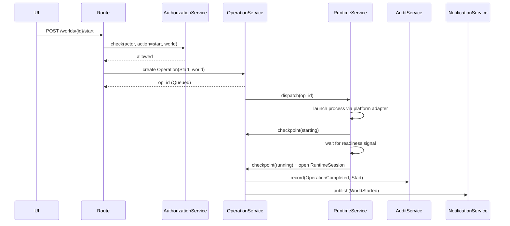
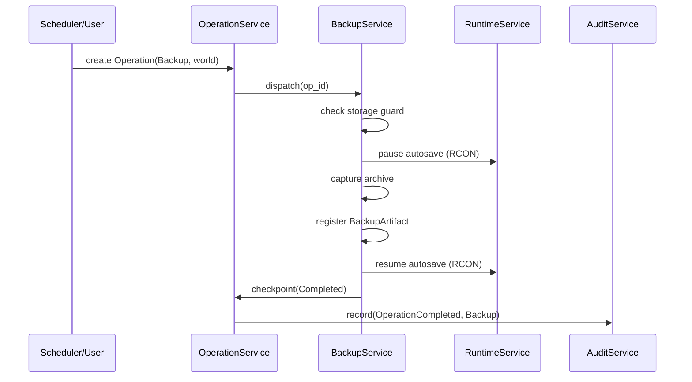
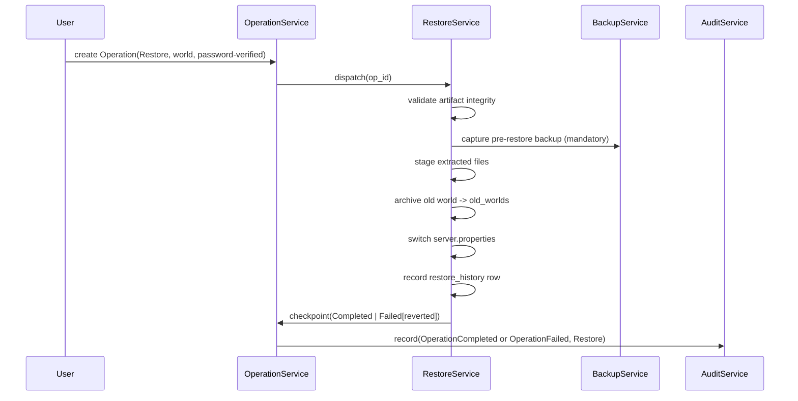
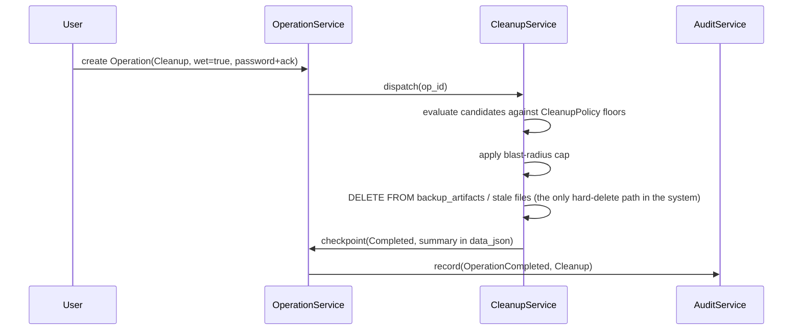
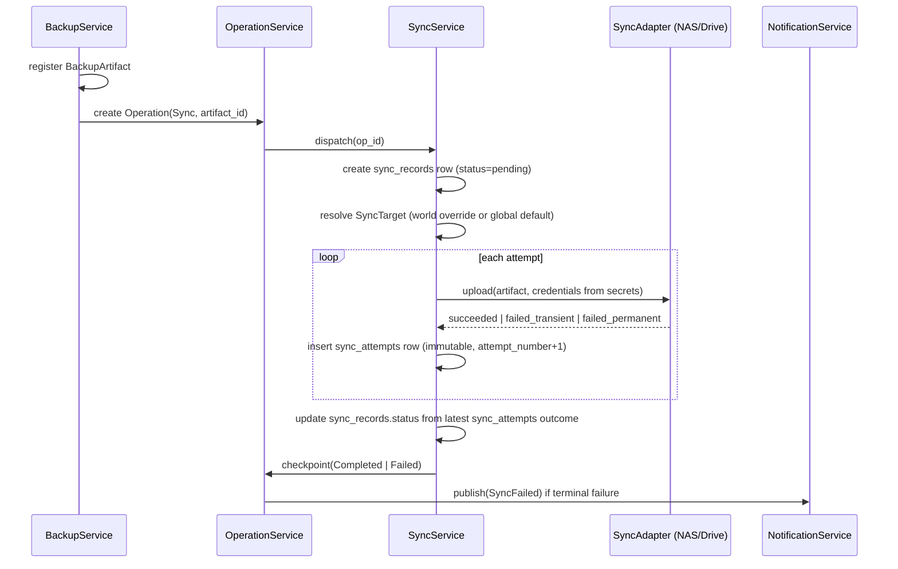
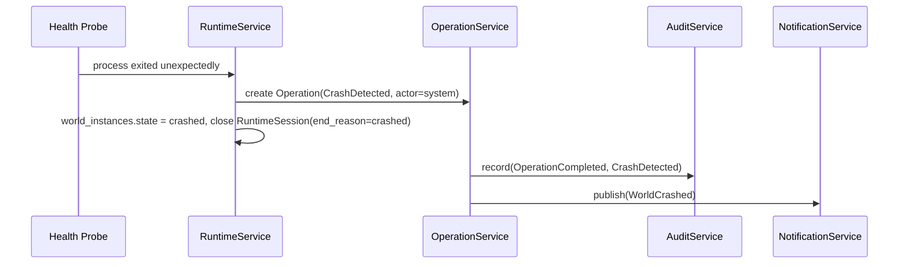

Document 8: Application Services & Operation Flows (Revision 2 — Full Expansion)

Purpose
- Turns Document 6 (Revision 6) and Document 7 (Revision 2) into concrete service behavior: who does what, in what order, with what retry/timeout/cancellation/concurrency rules.
- Closes as much of the Document 9 "Document 8 Expansion" checklist as a single pass reasonably can. A few items are explicitly flagged as deferred to the polishing session mentioned in conversation, rather than rushed — see §11.

1. Service Responsibilities & Boundaries

Each service is described as: what it owns, what it explicitly does not do, and which Doc 7 tables it touches.

**WorldService**
- Owns: world registry CRUD, template-based world creation orchestration (under a `CreateWorld` Operation), world listing/detail queries, tombstoning (under a `DeleteWorld` Operation).
- Does not: manage the live process, perform backup/restore/cleanup work itself — it delegates to RuntimeService/BackupService/RestoreService/CleanupService and only owns the `world_instances`/`world_settings` rows.
- Touches: `world_instances`, `world_settings`, `templates` (read), `java_runtimes` (read).

**RuntimeService**
- Owns: start/stop/kill mechanics via the platform adapter, RuntimeSession open/close, per-session RCON credential rotation, health probing, crash detection, WorldInstance state resolution.
- Does not: create or own the durable Operation record — it executes *under* an Operation dispatched by OperationService/SchedulerService and reports checkpoints back to it.
- Touches: `world_instances`, `runtime_sessions`, `secrets` (RCON only).

**OperationService**
- Owns: Operation creation, status transitions, checkpoint updates, idempotency-key lookups, timeout enforcement, cancellation (for cancellable types only). Also clears `world_instances.current_operation_id` back to `NULL` the moment a world-scoped Operation reaches any terminal status (decided in Doc 6 — previously unstated).
- Does not: know how to actually perform any domain action — it's the durable wrapper every other service's work happens inside, not a worker itself.
- Touches: `operations`.

**BackupService**
- Owns: backup capture (validate storage guard, pause autosave, flush/save, zip or snapshot, register `backup_artifacts`, resume autosave), RCON player notifications about backup start/end/failure, and triggering a `Sync` Operation immediately after a successful capture when a `SyncTarget` resolves for the world (world override or global default, per Doc 6 §2.17).
- Does not: decide *when* a backup should run (that's SchedulerService or a direct user request) — it only executes one, given an Operation. Also does not perform the sync transfer itself (SyncService's job) — it only dispatches the follow-on Operation.
- Touches: `backup_artifacts`, `operations` (checkpoints), `runtime_sessions` (read, to know if the world is live).

**RestoreService**
- Owns: the full restore workflow (validate artifact, stop world if required, create mandatory pre-restore backup, stage files, archive old world, switch `server.properties`, restart if previously running), `restore_history` recording.
- Does not: perform routine backups (delegates the pre-restore backup itself to BackupService rather than duplicating capture logic).
- Touches: `restore_history`, `backup_artifacts`, `world_instances`, `operations`.

**CleanupService**
- Owns: retention evaluation (dry-run and wet-run) against `cleanup_policies`, and — per Document 6's Global Deletion & Retention Model — is the *only* service in the entire system permitted to issue a physical `DELETE FROM` against any table, for any Tier 2 entity past its retention window.
- Does not: touch Tier 1 tables (`audit_records`, `notifications`, `notification_reads`, `missed_run_records`) at all — these are outside its sweep scope entirely, by design.
- Touches: `backup_artifacts` (file + row removal), stale world directories, and — generalized per Doc 6 — aged-out soft-deleted rows in `schedules`, `cleanup_policies`, `roles`, `permissions`, `role_assignments`, `client_sessions`, `sync_targets`, and (in principle, rarely in practice) `world_instances`, `devices`, `java_runtimes`, `templates`, `users`.

**SyncService** (new — fills the gap flagged in Revision 2)
- Owns: executing offsite sync transfers against a configured `SyncTarget` (NAS now, Google Drive later, per Doc 2 §4.4), recording each attempt as a `sync_records` row, and — unlike every other Operation type in this document — automatically retrying transient failures with backoff, since a network blip is a categorically different failure mode from a domain-state failure and retrying it is safe (the source artifact is immutable and untouched by a retry).
- Does not: decide *which* target a world syncs to, or manage credentials directly — target selection and credential entry belong to ConfigurationService (which owns `sync_targets` config), mirroring the existing Schedule/SchedulerService and CleanupPolicy/CleanupService split (one service owns the config, a different service executes against it).
- Does not: perform the backup itself — it's dispatched only after BackupService has already registered a `backup_artifacts` row; sync failure never rolls back or invalidates the local backup, which stands on its own regardless of offsite sync outcome.
- Touches: `sync_records` and `sync_attempts` (both Tier 1, permanent — `sync_attempts` holds the full per-try retry history, `sync_records` is the job-level status derived from it), `sync_targets` (read), `backup_artifacts` (read), `secrets` (credential read, via the platform sync adapter only — never exposed beyond it).
- Uses the existing "offsite sync adapter" slot already anticipated in Doc 3 §3.1/§5.14 — `NASSyncAdapter` now, `GoogleDriveSyncAdapter` later, both behind one `SyncAdapter` port so SyncService itself never changes when a new target type is added.

**SchedulerService**
- Owns: evaluating due `schedules`, dispatching the corresponding Operation when due, detecting and recording missed runs as `missed_run_records` (never resolving or deleting them itself — that's an operator action).
- Does not: perform the scheduled work itself (delegates to BackupService/CleanupService/etc. via a dispatched Operation).
- Touches: `schedules`, `missed_run_records` (create only), `operations` (create).

**AuthenticationService**
- Owns: username+password login, `client_sessions` issuance, password-retry throttling and lockout, step-up confirmation for sensitive actions.
- Does not: decide *what* an authenticated user is allowed to do — that's AuthorizationService.
- Touches: `users`, `secrets` (password verification), `client_sessions`, `devices` (context capture).

**AuthorizationService**
- Owns: policy evaluation for every privileged action — actor, role, direct permission, world scope, and current system safety state (e.g. storage guard) all factor in.
- Does not: perform authentication itself; assumes a valid, non-expired ClientSession is already established.
- Touches: `roles`, `role_assignments`, `permissions` (read-heavy).

**NotificationService**
- Owns: publishing `notifications` from Operation outcomes and system events, and lazily creating `notification_reads` rows as each user actually reads one.
- Does not: decide business logic about *whether* something warrants a notification beyond the fixed trigger list in §9 — that list is owned by product requirements (Doc 2 §7.3), not by this service's discretion.
- Touches: `notifications`, `notification_reads`.

**AuditService**
- Owns: writing `audit_records` for every state-changing action, denial, and suspicious event, including the actor/device snapshot captured at write time.
- Does not: ever update or delete an existing `audit_records` row — only ever inserts, including for corrections (via `annotation_of`).
- Touches: `audit_records`.

**FileManagerService**
- Owns: guarded browse/upload/download/rename/delete/move/copy for a world's own files (Doc 2 §5.1), independent of the DB-row deletion model entirely — deleting a Minecraft world *file* through the file manager is a different kind of deletion than the Tier 1/Tier 2 database rule in Doc 6, and is not routed through CleanupService. It requires privileged confirmation and produces its own `audit_records` entry, but it is a direct filesystem operation, not a domain-entity soft-delete.
- Touches: world filesystem directly (via platform adapter), `audit_records` (write).

**TemplateService** / **JavaRuntimeService**
- Own: CRUD and soft-deprecation of `templates` / `java_runtimes` respectively.
- Touch: `templates`, `java_runtimes`.

**ConfigurationService**
- Owns: guarded `server.properties` editing, and orchestrating `ConfigEdit` Operations for Schedule/CleanupPolicy/Role/Permission/SyncTarget edits and soft-deletes (per Doc 6's corrected deletion model — every edit or soft-delete of these entities is a `ConfigEdit` Operation, not a direct silent write).
- Enforces optimistic concurrency on Schedule/CleanupPolicy edits (decided in Doc 6 §2.6/§2.7): an edit submitted against a stale `version` is rejected with a conflict error rather than silently overwriting a concurrent change.
- Touches: `world_settings`, `global_settings`, `schedules`, `cleanup_policies`, `roles`, `permissions`, `role_assignments`, `sync_targets` (write, always via a logged `ConfigEdit`).

**MetricsService**
- Owns: the cadence rules from Doc 1 §1 (paused when off + 0 clients, slow cadence when on + 0 clients, 1Hz broadcast when >=1 client), snapshot caching for instant first paint.
- Touches: no persistent table directly — reads live state from `world_instances`/`runtime_sessions` and broadcasts; nothing here is itself durable, per Doc 7 §2's "Do NOT Persist: Live CPU/RAM metrics" rule.

2. Command Flow Per Operation Type

All flows follow the same shape from the original Doc 8 §4 ("Standard Operation Flow"): authorize -> validate preconditions -> create Operation -> queue -> dispatch -> execute with checkpoints -> audit -> notify -> terminal status. What differs per type is the preconditions and the domain service invoked.

| Operation Type | Preconditions | Domain Service | Terminal Success State |
|---|---|---|---|
| CreateWorld | valid Template, non-conflicting port/addressing, authorization passes | WorldService | new `world_instances` row, `state = off` |
| Start | world = `off`, storage guard passes, not in 10s cooldown | RuntimeService | `world_instances.state = running`, new `runtime_sessions` row |
| Stop | world != `off`, password verified | RuntimeService | `world_instances.state = off`, `runtime_sessions.ended_at` set |
| Kill | world = `running`/`stopping` (escalation path), password step-up + elevated confirmation | RuntimeService | same as Stop, `end_reason = forced_stop` |
| Backup | no backup/restore/cleanup currently running for this world, storage guard passes | BackupService | new `backup_artifacts` row, world returns to `pre_backup_state` |
| Restore | world = `off`, no backup/cleanup running, valid artifact | RestoreService | `restore_history` row, world back to `off` |
| Cleanup | no backup/restore running for the affected scope | CleanupService | `cleanup_run` summary in `operations.data_json`, any actual row/file removal performed |
| Sync | backup just completed, a `SyncTarget` resolves for the world (override or global default) | SyncService | new `sync_records` row (`succeeded`), artifact now mirrored offsite |
| ConfigEdit | authorization passes for the specific config category | ConfigurationService | updated row + `deleted_at`/`revoked` marker if applicable, always with an `audit_records` entry |
| CrashDetected | none (system-observed, not user-requested) | RuntimeService | `world_instances.state = crashed`, actor_type = `system` |
| DeleteWorld | world = `off`, no backup/restore/cleanup running for this world, password step-up + elevated confirmation | WorldService | `world_instances.deleted_at` set (tombstoned), files removed from disk |

**Gap closed this pass**: `CreateWorld` and `DeleteWorld` were previously missing from this table entirely — world creation and deletion had no driving Operation type, no idempotency guard, and no standard authorize→validate→audit→notify flow, despite being two of the most common actions in the product. Both are now first-class Operation types rather than folded into `ConfigEdit`, since both are structurally heavier than a field edit.

**"Elevated confirmation" defined (resolved ambiguity from project recheck)**: everywhere this phrase appears in this document, it means *both* of the following, not just a UI "are you sure?" dialog — (1) password step-up per Doc 2 §8.2 (re-entry of the acting user's password, even for an already-authenticated session), and (2) an explicit scope-preview confirmation screen per Doc 2 §8.4 for destructive actions (showing exactly what will be affected before the user commits). `Kill` and `DeleteWorld` both require this; `Stop` and `Restore` already required password verification under their existing preconditions, which now reads as the same "elevated confirmation" concept for consistency.

3. Query Responsibilities (not every read needs a full service — this maps read to owner)

- World list / detail -> WorldService (composes RuntimeService's live state + BackupService's last-backup summary).
- Live metrics -> MetricsService.
- Operation history / status -> OperationService.
- Backup/restore inventory -> BackupService / RestoreService.
- Notifications (unread count, list) -> NotificationService, joined against `notification_reads` for the requesting user.
- Audit/history views -> AuditService.
- Missed-run list -> SchedulerService.
- Device/user/role management views -> AuthenticationService / AuthorizationService.

4. Sequence Diagrams

4.1 Start

4.2 Backup (world running)

4.3 Restore

4.4 Cleanup (wet run)

4.5 Sync (automatic, after backup)

4.6 Crash Detection

(ConfigEdit and Kill sequence diagrams follow the same shape as above and are deferred to the polishing session rather than drawn out here — they don't introduce new structural patterns beyond what's shown.)

5. Scheduler Behavior (expanded)

- SchedulerService evaluates all enabled `schedules` on a fixed tick (candidate default: every 30s, matching the legacy cadence noted in `legacyImplementation.txt`) — exact interval is a polishing-session tuning decision, not a structural one.
- For each due schedule: check for a conflicting in-flight Operation for the same scope (per the conflict matrix in §7); if clear, create and dispatch the Operation; if not clear or the tick was missed entirely (manager was down, or a prior tick was skipped), create a `missed_run_records` row instead of silently catching up — per Doc 1 §13's "missed runs are not run automatically to catch up."
- A missed run is never retried automatically by the scheduler. It sits `pending` until an operator marks it `resolved` (by manually running the job) or `ignored`.

6. Retry, Timeout, and Cancellation Policy

| Operation Type | Auto-retry? | Timeout | Cancellable? |
|---|---|---|---|
| CreateWorld | No | Short — mostly directory/registry setup, no long-running I/O | Only while `Queued`/`Validating`, before directories are provisioned |
| Start | No (duplicate-start guard + cooldown prevents re-trigger; a failed start requires new explicit user action) | Configurable, default candidate 120s waiting for readiness signal | No — once `Running`, stopping the launch mid-flight is a Kill, not a cancel |
| Stop | No | 60s before escalating to Kill | No |
| Kill | No | Short — process-level, not log-pattern-based | No |
| Backup | No (a failed backup is surfaced; retry is a new manual/scheduled trigger, not automatic) | Configurable per world size; no artifact is created until success, so a timeout is equivalent to failure | Only while `Queued`/`Validating`, before capture actually starts |
| Restore | No | Longer default, given file I/O volume | Only while `Queued`/`Validating` — once staging begins, it must run to a terminal state (success or safely-reverted failure) |
| Cleanup | No | Configurable, scales with candidate-set size | Yes, while `Queued`/`Validating`, and dry-runs are inherently low-risk to cancel |
| Sync | **Yes — the one exception in this table.** Automatic retry with exponential backoff (default candidate: 3 attempts) for transient failures (network unreachable, timeout); permanent failures (auth rejected, target full) go straight to `Failed` | Per-attempt timeout, configurable; an outer timeout also bounds the overall job across all retries | **Yes, even while `Running`** — the other exception in this table. Aborting a file transfer to a remote target is safe mid-flight since the local artifact being copied is untouched and immutable; this is unlike every other Operation type, where `Running` means real-world side effects are already underway that can't be cleanly unwound |
| ConfigEdit | N/A — these are typically synchronous, fast operations; timeout policy is a formality here | Short | No — a config edit either applies or is rejected at validation, there's no meaningful mid-flight state to cancel |
| CrashDetected | N/A — this is a system observation, not a retryable action | N/A | No |
| DeleteWorld | No | Configurable, scales with world size (file removal volume) | Only while `Queued`/`Validating`, before file removal begins |

- General rule (already established in Doc 6 §2.4): `Cancelled` is only reachable from `Queued`/`Validating`. Nothing is cancellable once `Running`, because by definition the domain service has already started doing something with real-world side effects (a running process, a partially-written archive, files being staged) that a naive cancel can't safely unwind. Kill exists precisely as the safe way to interrupt a `running` world; there is no equivalent "cancel" for an in-flight Backup or Restore — they must run to a terminal state.
- Sync is the deliberate exception to both general rules above (no auto-retry, no cancellation once `Running`). Network transfer failures and mid-transfer aborts don't carry the same irreversibility risk as a partially-started process launch, backup capture, or restore, so the stricter rules that protect those don't need to apply here — the thing being moved already exists safely elsewhere before the transfer even starts.

7. Concurrency and Conflict Matrix

Formalizes the previously-scattered rules from Doc 1 §14 and Doc 3 §7.3 into one table.

| | Backup (same world) | Restore (same world) | Cleanup (same world/global scope) | Start/Stop (same world) |
|---|---|---|---|---|
| **Backup running** | queue (single-flight, not rejected) | reject until backup finishes | reject until backup finishes | Stop is queued, not blocked; Start is irrelevant (world already has a session) |
| **Restore running** | reject until restore finishes | reject (single-flight) | reject until restore finishes | Start/Stop both rejected — world must stay `off` throughout restore |
| **Cleanup running** | reject until cleanup finishes | reject until cleanup finishes | reject (single-flight per scope) | not affected |
| **Global storage guard tripped (<10% or estimated job exceeds free space)** | blocked, system-wide, not just this world | blocked, system-wide | cleanup is typically what's *triggered* by this condition, not blocked by it | Start blocked system-wide; Stop always allowed |

- Priority ordering when multiple *want* to run: Backup > Restore > Cleanup (Doc 1 §14), enforced by CleanupService/RestoreService checking for an in-flight Backup before proceeding, not by a general-purpose scheduler queue.
- `DeleteWorld` follows the same conflict rules as Restore: it requires the world to be `off` and rejects outright (not queues) if a Backup, Restore, or Cleanup is in flight for that world — deleting a world out from under an in-progress operation on it is never allowed.
- Locking granularity: Backup/Restore/Cleanup conflicts are evaluated per-world for world-scoped operations, but the storage guard is a **global** lock — it blocks Start/Backup for every world simultaneously once tripped, since disk space is a shared host resource (Doc 1 §2/§3, Doc 2 §11.2's "modest home-lab hardware" framing).
- Multi-client duplicate-trigger handling (restated from original Doc 1 §14, now tied to the Operation model): Backup requests reuse/queue against the existing idempotency key; Restore and Cleanup requests reject a second trigger outright while one is in flight; Start ignores subsequent triggers until state returns to `off`; Stop is safe to call repeatedly (idempotent, just disable the button once not `running`).
- Sync operations are single-flight per artifact (no duplicate concurrent upload of the same `backup_artifacts` row), but are independent of the Backup/Restore/Cleanup/Start/Stop matrix above — a Sync in progress does not block or get blocked by any of those, since it only reads an already-immutable artifact file and never touches live world state. A configurable global concurrency cap (e.g. max N simultaneous transfers) is recommended given the modest-hardware target in Doc 2 §11.1, to avoid saturating bandwidth/CPU when many worlds sync at once.

8. Failure Recovery (ties to Doc 7 §6 reconciliation, adds service-level specifics)

- **Start** left `Validating`/`Running` past a manager restart with no matching discovered process -> `Failed`, `error_code = manager_restart_incomplete`, world state resolved to `off`.
- **Backup** interrupted by crash or restart -> `Failed`; no `backup_artifacts` row is ever created for a failed attempt (Doc 6 §2.5), so there's nothing to clean up on that side — only the Operation's terminal state needs setting.
- **Restore** interrupted mid-flight -> per Doc 1 §3, there is no dedicated undo; recovery is: operator manually re-runs Restore using the pre-restore backup that was mandatorily created at the start of the interrupted attempt. This is a **known, accepted product limitation**, not something this revision tries to solve architecturally — flagged again here so it doesn't get silently "fixed" into a false sense of full transactionality later.
- **Cleanup** interrupted mid-delete -> partial deletion is possible; recovery is that the next Cleanup evaluation simply re-evaluates current state and continues — idempotent by construction, since candidate discovery is always computed fresh against current file/row state, never against a stale plan.

9. Notification Pipeline

- Trigger list (from Doc 2 §7.3, restated as the fixed set NotificationService acts on): world started/stopped/crashed, world being backed up/restored, sync failure, suspicious client activity, unauthorized action attempts, critical low storage, missed scheduled jobs.
- Every trigger creates exactly one `notifications` row (Tier 1, permanent). `notification_reads` rows are created lazily, one per user, only when that user actually views the notification — not fanned out to every user upfront, since most notifications are seen by whoever's actively looking at the time and pre-creating rows for every registered user would be pure waste.
- Severity mapping (draft, refine in polishing session): crash/unauthorized-attempt/critical-storage = `error`; backup-failed/sync-failure/missed-job = `warning`; started/stopped/backup-succeeded = `info`.

10. Audit Pipeline

- Every Operation's creation and every terminal status transition produces exactly one `audit_records` row.
- Every `ConfigEdit` produces an `audit_records` row carrying a before/after diff in `payload` (not just "something changed").
- Every login attempt (success or failure) and every authorization denial produces an `audit_records` row, with `device_id_snapshot`/`device_name_snapshot` captured at that moment per Doc 6 §1.1 — regardless of what happens to the Device row later.
- AuditService never updates or deletes; corrections use `annotation_of` to point at the record being corrected, per Doc 6 §2.9.

11. Service-to-Entity Mapping (summary table)

| Service | Primary Entities |
|---|---|
| WorldService | WorldInstance, Template (read), JavaRuntime (read) |
| RuntimeService | WorldInstance, RuntimeSession |
| OperationService | Operation |
| BackupService | BackupArtifact |
| RestoreService | RestoreHistory |
| CleanupService | CleanupPolicy, BackupArtifact (delete), stale files |
| SyncService | SyncTarget (read), SyncRecord, SyncAttempt |
| SchedulerService | Schedule, MissedRunRecord |
| AuthenticationService | User, ClientSession, Secret |
| AuthorizationService | Role, RoleAssignment, Permission |
| NotificationService | Notification, NotificationRead |
| AuditService | AuditRecord |
| FileManagerService | (world filesystem, not a DB entity) |
| TemplateService | Template |
| JavaRuntimeService | JavaRuntime |
| ConfigurationService | WorldSettings, GlobalSettings, Schedule, CleanupPolicy, Role, Permission |
| MetricsService | (none persisted) |

12. Document 8 Checklist Status

Cross-checking against Document 9's "Document 8 Expansion" list:
- [x] Expand every application service — §1.
- [x] Define service responsibilities — §1.
- [x] Define service boundaries — §1 ("Does not" lines).
- [x] Define command flow for every operation — §2.
- [x] Define query responsibilities — §3.
- [~] Add sequence diagrams — §4 covers Start, Backup, Restore, Cleanup, Sync, Crash Detection. ConfigEdit and Kill are deferred to the polishing session (noted inline in §4) since they don't add new structural patterns.
- [x] Expand scheduler behavior — §5.
- [x] Define retry policies — §6.
- [x] Define timeout behavior — §6.
- [x] Define cancellation behavior — §6.
- [x] Define failure recovery — §8.
- [x] Define concurrency rules — §7.
- [x] Define notification pipeline — §9.
- [x] Define audit pipeline — §10.
- [x] Map services to domain entities — §11.

Explicitly deferred to the polishing session (flagged rather than guessed at now):
- Exact numeric timeout/retry/scheduler-tick values in §5/§6 are marked as candidates, not locked constants.
- Sync/ConfigEdit/Kill sequence diagrams — Sync is now covered (§4.5); ConfigEdit, Kill, CreateWorld, and DeleteWorld remain deferred (all follow the same structural shape as diagrams already drawn).
- The `permissions` CHECK constraint noted as outstanding in Document 7 is a natural companion fix for the same session, since ConfigurationService is what will actually write those rows.

Resolved this pass (full project recheck): `CreateWorld` and `DeleteWorld` added as first-class Operation types, closing a gap where world creation/deletion had no driving Operation, idempotency guard, or standard audit/notify flow (§2, §6, §7). Optimistic concurrency on Schedule/CleanupPolicy `version` and the `current_operation_id` clearing rule are now explicit (§1). `CleanupHardDeletePerformed` granularity (once per row) is settled in Document 6. `BackupService`'s ownership of dispatching the follow-on `Sync` Operation is now stated explicitly (§1), matching what the sequence diagram already showed. "Elevated confirmation" is now defined once, precisely, and applied consistently to `Kill` and `DeleteWorld` (§2).

Resolved this revision: SyncService is now a named, fully-specified service (§1), with its own command flow, sequence diagram, and the two deliberate exceptions to the retry/cancellation rules justified in §6. This closes the gap flagged at the end of the previous revision. Three new domain entities this introduces — `SyncTarget`, `SyncRecord`, and `SyncAttempt` — are added to Document 6 and Document 7 to keep the domain model and schema consistent with this service definition; see those documents for the entity-level detail.
