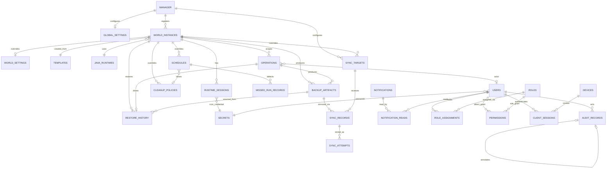

# Document 7: Database Schema & Persistence Design

Purpose
- Turn Document 6's domain model into a buildable SQLite schema: every table, column, type, key, index, constraint.
- Downstream of Docs 6 and 10 — where this document names a rule (deletion tiers, secrets storage), it applies a decision already made there.

0. Conventions (apply to every table below unless stated otherwise)

- **IDs**: `TEXT`, application-generated (UUIDv4 or similar), never auto-increment integers for anything cross-referenced or stable across export/import. `INTEGER PRIMARY KEY AUTOINCREMENT` acceptable only for purely internal, never-externally-referenced rows (none currently).
- **Timestamps**: `INTEGER`, Unix epoch seconds (Doc 1 §9).
- **Booleans**: `INTEGER` (0/1).
- **JSON payloads**: `TEXT`, application-validated; SQLite JSON1 may query them, but no column is declared as a native JSON type.
- **Standard columns**:
  - Every table has `created_at INTEGER` except `schema_migrations` (uses `applied_at`), `notification_reads` (uses `read_at`/`dismissed_at`), `role_assignments`/`permissions` (use `granted_at`).
  - Every Tier 2 table (Doc 6 §0 Global Deletion & Retention Model) has `deleted_at INTEGER NULL` (the only "deleted" signal; non-null = the sole deletion marker) and `deleted_by TEXT NULL` (user_id or `'system'`). Exceptions: the singleton tables `manager` and `global_settings` are never deleted and have no such columns.
  - Tier 1 tables (`audit_records`, `notifications`, `notification_reads`, `missed_run_records`, `sync_records`, `sync_attempts`) have no `deleted_at` at all — nothing ever removes them.
  - Table listings below omit `created_at`, `deleted_at`, `deleted_by` where the convention applies and show only non-standard columns.
- **FK enforcement is the deletability boundary**: every FK is `ON DELETE RESTRICT` unless stated otherwise. Anything that must outlive its referent stores the ID as a plain value plus a denormalized snapshot of identifying fields at write time (Doc 6 snapshot pattern: `audit_records.device_id_snapshot`, `missed_run_records.schedule_name_snapshot`, `runtime_sessions.launch_args_snapshot`). Cleanup's hard-delete eligibility for a Tier 2 row = "does anything still hold an enforced FK to me."
- **No `ON DELETE CASCADE` anywhere.** Only the Cleanup subsystem performs physical deletes, and it checks dependents explicitly rather than relying on cascading SQL.

1. Full Table List

- Manager/global: `manager`, `global_settings`, `schema_migrations`
- World/registry: `world_instances`, `world_settings`, `templates`, `java_runtimes`
- Runtime: `runtime_sessions`, `operations`
- Backup/restore/retention: `backup_artifacts`, `restore_history`, `schedules`, `missed_run_records`, `cleanup_policies`
- Sync: `sync_targets`, `sync_records`, `sync_attempts`
- Notifications/audit: `notifications`, `notification_reads`, `audit_records`
- Identity/security: `users`, `roles`, `role_assignments`, `permissions`, `devices`, `client_sessions`, `secrets`

(27 tables.)

2. Table Definitions

Unless noted, every Tier 2 table below implicitly has `deleted_at`/`deleted_by`; every table implicitly has `created_at` (§0).

2.1 manager (singleton — one row, enforced at application layer)
| Column | Type | Notes |
|---|---|---|
| manager_id | TEXT | PK |
| deployed_version | TEXT | current commit/version reference, Doc 1 §17 |
| setup_completed | INTEGER | |
| updated_at | INTEGER | |

2.2 global_settings (singleton — defaults inherited by any world without an override in `world_settings`)
| Column | Type | Notes |
|---|---|---|
| settings_id | TEXT | PK |
| timezone | TEXT | IANA name; all scheduling computed in epoch regardless |
| idle_countdown_seconds | INTEGER | |
| notification_defaults | TEXT (JSON) | sounds, message templates, repetition |
| minecraft_root_path / backup_root_path / log_root_path | TEXT | |
| offsite_sync_defaults | TEXT (JSON) | method + non-secret config; credentials in `secrets` |
| version | INTEGER | optimistic concurrency (Doc 11 §4) |
| updated_at | INTEGER | |
| updated_by | TEXT | FK -> users.user_id, RESTRICT |

2.3 schema_migrations
| Column | Type | Notes |
|---|---|---|
| version | INTEGER | PK, sequential |
| name | TEXT | |
| applied_at | INTEGER | |

2.4 world_instances (Tier 2 — tombstoned, never hard-deleted in practice per Doc 6)
| Column | Type | Notes |
|---|---|---|
| world_id | TEXT | PK, immutable forever, even past `deleted_at` |
| display_name | TEXT | unique where `deleted_at IS NULL` |
| template_id | TEXT | FK -> templates.template_id, RESTRICT |
| server_type | TEXT | vanilla/forge/fabric/paper/etc |
| mc_version | TEXT | |
| java_runtime_id | TEXT | FK -> java_runtimes.runtime_id, RESTRICT |
| port | INTEGER | unique where `deleted_at IS NULL` |
| addressing_strategy | TEXT | subdomain/port/path, Doc 2 §1.3 |
| addressing_value | TEXT | assigned subdomain/path |
| state | TEXT | off/queued/starting/running/stopping/restoring/backing_up/crashed/error, Doc 6 §2.3 |
| pre_backup_state | TEXT NULL | set only while `state = backing_up`, Doc 6 §2.3 |
| current_operation_id | TEXT NULL | FK -> operations.op_id, RESTRICT; cleared to `NULL` by OperationService the moment the Operation reaches a terminal status |
| launch_args | TEXT (JSON) | default startup args; editable only while `state = off` (Doc 6 §4, Doc 11 §5) |
| metadata_version | INTEGER | optimistic concurrency for `display_name`/metadata edits only (`ConfigEdit`/RenameWorld, Doc 11 §4); the operational `state` machine is never version-checked |
| updated_at | INTEGER | |
| updated_by | TEXT NULL | FK -> users.user_id, RESTRICT |

Indexes: `(state)` (homepage "running worlds" query, Doc 5); `(deleted_at)` partial (active-world filtering); `(display_name)` (search/filter at scale, Doc 5).

2.5 world_settings (per-world override of global_settings; 1:1 with world_instances, present only when overridden)
| Column | Type | Notes |
|---|---|---|
| world_id | TEXT | PK, FK -> world_instances.world_id, RESTRICT |
| minecraft_root_override / backup_root_override / log_root_override | TEXT NULL | |
| offsite_sync_override | TEXT (JSON) NULL | |
| idle_countdown_override | INTEGER NULL | closes the one setting that lacked a per-world override (Doc 6 §2.10 three-tier inheritance) |
| version | INTEGER | optimistic concurrency (Doc 11 §4) |
| updated_at | INTEGER | |
| updated_by | TEXT | FK -> users.user_id, RESTRICT |

Note: `notification_defaults` deliberately has no per-world override (Doc 6 §2.10).

2.6 templates (Tier 2 — soft-deleted/deprecated only, Doc 6 §2.12)
| Column | Type | Notes |
|---|---|---|
| template_id | TEXT | PK |
| name | TEXT | unique where `deleted_at IS NULL` |
| category | TEXT | free-text, not a closed enum — adding Quilt/Purpur/NeoForge/Sponge is a new row, provided `config_defaults` can launch it |
| default_version | TEXT | |
| config_defaults | TEXT (JSON) | must include a generic launch-command template (executable pattern, jar/args placeholders) generic enough for the platform adapter to launch any category from data alone — the mechanism making server types data-driven |
| source | TEXT | built_in / imported |
| deprecated | INTEGER | distinct from `deleted_at`; hidden from "create new world" but still referenced historically |
| version | INTEGER | optimistic concurrency (Doc 11 §4) |
| updated_at | INTEGER | |

2.7 java_runtimes (Tier 2 — soft-deprecated only, Doc 6 §2.11)
| Column | Type | Notes |
|---|---|---|
| runtime_id | TEXT | PK |
| label | TEXT | unique where `deleted_at IS NULL` |
| executable_path | TEXT | |
| version_detected | TEXT | |
| status | TEXT | registered/verified/missing/deprecated |
| updated_at | INTEGER | |

2.8 runtime_sessions (Tier 2 in principle, practically permanent — every FK into/out of it is RESTRICT)
| Column | Type | Notes |
|---|---|---|
| session_id | TEXT | PK |
| world_id | TEXT | FK -> world_instances.world_id, RESTRICT |
| started_at | INTEGER | set only at confirmed `running`, Doc 6 §2.2 |
| ended_at | INTEGER NULL | |
| end_reason | TEXT NULL | graceful_stop/forced_stop/crashed/emergency_stop/reconciled_missing |
| rcon_secret_id | TEXT | FK -> secrets.secret_id, RESTRICT |
| port_used | INTEGER | |
| java_runtime_id | TEXT | FK -> java_runtimes.runtime_id, RESTRICT; historical, not necessarily the world's current runtime |
| launch_args_snapshot | TEXT (JSON) | captured at launch; independent of later `world_instances.launch_args` edits |

Constraint: partial unique index on `world_id WHERE ended_at IS NULL` — one open session per world, DB-enforced. Do NOT persist here: process PID/handle, live health-check results (runtime-registry concerns, Doc 3 §7.4).

2.9 operations (durable command-plane record; immutable except status progression, Doc 6)
| Column | Type | Notes |
|---|---|---|
| op_id | TEXT | PK |
| op_type | TEXT | CreateWorld/Start/Stop/Kill/Backup/Restore/Cleanup/Sync/ConfigEdit/CrashDetected/DeleteWorld |
| world_id | TEXT NULL | FK -> world_instances.world_id, RESTRICT; null for manager-global operations |
| actor_type | TEXT | user / system |
| actor_user_id | TEXT NULL | FK -> users.user_id, RESTRICT; null when actor_type = system |
| idempotency_key | TEXT NULL | |
| status | TEXT | Created/Queued/Validating/Running/Completed/Failed/Cancelled/TimedOut |
| checkpoint | TEXT (JSON) NULL | |
| attempt | INTEGER | |
| compensates_operation_id | TEXT NULL | FK -> operations.op_id, RESTRICT; set only on a compensating Operation (e.g. auto restore-revert), Doc 6 §2.4 |
| intent_at | INTEGER | |
| started_at | INTEGER NULL | |
| finished_at | INTEGER NULL | |
| error_code | TEXT NULL | |
| message | TEXT NULL | |
| data_json | TEXT (JSON) NULL | type-specific payload, incl. cleanup-run summaries (deleted count, freed bytes, errors) — no separate cleanup-run table needed |
| updated_at | INTEGER | |

Indexes: `(world_id, status)`; `(idempotency_key)` unique where not null, scoped by `op_type`.

2.10 backup_artifacts (Tier 2, created-on-success-only, Doc 6 §2.5)
| Column | Type | Notes |
|---|---|---|
| artifact_id | TEXT | PK |
| world_id | TEXT NULL | FK -> world_instances.world_id, RESTRICT; **NULL = ManagerBackup** (manager DB/settings/templates/permissions) |
| category | TEXT | session_end/manual/scheduled/pre_restore/emergency/manager_config |
| storage_path | TEXT | |
| size_bytes | INTEGER | |
| checksum | TEXT | |
| operation_id | TEXT | FK -> operations.op_id, RESTRICT — the Backup Operation that produced it |
| deleted_by | TEXT NULL | (soft only; file removed from disk, row + metadata retained) |

Indexes: `(world_id, category, created_at)` — the shape retention rules need for "keep newest N per category."

2.11 restore_history (Tier 1-adjacent — immutable, append-only outcome record per Doc 2 §4.3; its own table because it needs structured, queryable fields)
| Column | Type | Notes |
|---|---|---|
| restore_id | TEXT | PK |
| world_id | TEXT | FK -> world_instances.world_id, RESTRICT |
| operation_id | TEXT | FK -> operations.op_id, RESTRICT |
| source_artifact_id | TEXT NULL | FK -> backup_artifacts.artifact_id, RESTRICT; null if source was a raw snapshot path |
| pre_restore_artifact_id | TEXT | FK -> backup_artifacts.artifact_id, RESTRICT — the mandatory pre-restore backup, Doc 2 §4.3 |
| operator_user_id | TEXT | FK -> users.user_id, RESTRICT |
| outcome | TEXT | success/failed/reverted |
| rollback_of_restore_id | TEXT NULL | FK -> restore_history.restore_id, RESTRICT — self-reference for a corrective restore |
| started_at | INTEGER | |
| finished_at | INTEGER NULL | |

2.12 schedules (Tier 2, Doc 6 §2.6)
| Column | Type | Notes |
|---|---|---|
| schedule_id | TEXT | PK |
| scope | TEXT | global / world |
| world_id | TEXT NULL | FK -> world_instances.world_id, RESTRICT; null when scope = global |
| schedule_type | TEXT | backup / cleanup / maintenance |
| interval_spec | TEXT (JSON) | daily/weekly/monthly/every_n_days + parameters |
| time_of_day | TEXT | |
| enabled | INTEGER | |
| version | INTEGER | bumped on every edit (Doc 6 §2.6; optimistic concurrency, Doc 11 §4) |
| last_changed_by | TEXT | FK -> users.user_id, RESTRICT |
| last_changed_at | INTEGER | |

2.13 missed_run_records (Tier 1 — permanent; no `deleted_at` column exists at all, Doc 6 §2.6.1)
| Column | Type | Notes |
|---|---|---|
| missed_run_id | TEXT | PK |
| schedule_id | TEXT | plain value, **not an enforced FK** — this row must outlive the schedule |
| schedule_name_snapshot | TEXT | captured at detection time |
| schedule_type_snapshot | TEXT | captured at detection time |
| expected_run_at | INTEGER | |
| detected_at | INTEGER | |
| resolution | TEXT | pending / resolved / ignored |
| resolution_at | INTEGER NULL | |
| resolution_by | TEXT NULL | user_id, plain value, not an enforced FK (same reasoning) |

2.14 cleanup_policies (Tier 2, Doc 6 §2.7)
| Column | Type | Notes |
|---|---|---|
| policy_id | TEXT | PK |
| scope | TEXT | global / world |
| world_id | TEXT NULL | FK -> world_instances.world_id, RESTRICT |
| age_rule_days | INTEGER | floor of 3, enforced at application layer (Doc 6 §2.7) |
| space_rule_pct | INTEGER NULL | |
| count_rules | TEXT (JSON) | per-category floors (session/manual/pre_restore/emergency), each >= 3 |
| schedule_id | TEXT NULL | FK -> schedules.schedule_id, RESTRICT |
| version | INTEGER | |
| last_changed_by | TEXT | FK -> users.user_id, RESTRICT |
| last_changed_at | INTEGER | |

2.15 notifications (Tier 1 — permanent, Doc 6 §2.8)
| Column | Type | Notes |
|---|---|---|
| notification_id | TEXT | PK |
| category | TEXT | |
| severity | TEXT | critical/high/normal/informational (drives dropdown prioritization, Doc 5) |
| message | TEXT | |
| related_operation_id | TEXT NULL | FK -> operations.op_id, RESTRICT |
| related_world_id | TEXT NULL | FK -> world_instances.world_id, RESTRICT |
| requires_action | INTEGER | |
| action_taken | TEXT NULL | |

2.16 notification_reads (Tier 1 — permanent, Doc 6 §2.8; per-user read state)
| Column | Type | Notes |
|---|---|---|
| notification_id | TEXT | PK (composite), FK -> notifications.notification_id, RESTRICT |
| user_id | TEXT | PK (composite), FK -> users.user_id, RESTRICT |
| read_at | INTEGER NULL | |
| dismissed_at | INTEGER NULL | clears the notification from *this user's* active dropdown view (Doc 5) only; the notification row is never affected |

2.17 audit_records (Tier 1 — permanent, append-only, Doc 6 §2.9)
| Column | Type | Notes |
|---|---|---|
| audit_id | TEXT | PK |
| event_type | TEXT | |
| actor_type | TEXT | user / system |
| actor_user_id | TEXT NULL | plain value, **not an enforced FK** — must survive a soft-deleted User |
| device_id_snapshot / device_name_snapshot / ip_snapshot | TEXT NULL | plain values, not enforced FKs — captured at write time (Doc 6 §1.1) |
| operation_id | TEXT NULL | FK -> operations.op_id, RESTRICT |
| world_id | TEXT NULL | FK -> world_instances.world_id, RESTRICT |
| payload | TEXT (JSON) NULL | |
| annotation_of | TEXT NULL | FK -> audit_records.audit_id, RESTRICT — self-reference for corrections (Doc 6 §2.9) |

Indexes: `(created_at)`, `(actor_user_id)`, `(world_id)` — audit views filter by all three.

2.18 users (Tier 2 — soft-deleted, Doc 6 §1.1/§2.1)
| Column | Type | Notes |
|---|---|---|
| user_id | TEXT | PK |
| username | TEXT | unique where `deleted_at IS NULL` |
| display_name | TEXT NULL | |
| secret_id | TEXT | FK -> secrets.secret_id, RESTRICT — password hash reference, Doc 10 §2.2 |
| status | TEXT | active/disabled/locked |
| failed_login_count | INTEGER | |
| locked_until | INTEGER NULL | |
| created_by | TEXT NULL | FK -> users.user_id, RESTRICT — self-reference |
| updated_at | INTEGER | |

2.19 roles (Tier 2 for custom roles; the three baseline roles never get `deleted_at` set, enforced at application layer, Doc 6 §2.15)
| Column | Type | Notes |
|---|---|---|
| role_id | TEXT | PK |
| name | TEXT | unique where `deleted_at IS NULL` |
| description | TEXT NULL | |
| is_system_role | INTEGER | true for Client / Admin / Superadmin |
| version | INTEGER | optimistic concurrency (Doc 11 §4) |
| updated_at | INTEGER | |

2.20 role_assignments (Tier 2, Doc 6 §2.16)
| Column | Type | Notes |
|---|---|---|
| assignment_id | TEXT | PK |
| user_id | TEXT | FK -> users.user_id, RESTRICT |
| role_id | TEXT | FK -> roles.role_id, RESTRICT |
| granted_at | INTEGER | |
| granted_by | TEXT | FK -> users.user_id, RESTRICT |

Constraint: unique `(user_id, role_id)` where `deleted_at IS NULL`.

2.21 permissions (Tier 2, Doc 6 §2.16)
| Column | Type | Notes |
|---|---|---|
| permission_id | TEXT | PK |
| role_id | TEXT NULL | FK -> roles.role_id, RESTRICT |
| user_id | TEXT NULL | FK -> users.user_id, RESTRICT |
| action_category | TEXT | |
| world_id | TEXT NULL | FK -> world_instances.world_id, RESTRICT; null = global grant |
| granted_at | INTEGER | |
| granted_by | TEXT | FK -> users.user_id, RESTRICT |

Constraint (expressible in SQLite, must be written as real DDL): exactly one of `role_id`/`user_id` non-null: `CHECK ((role_id IS NOT NULL) != (user_id IS NOT NULL))`.

2.22 devices (Tier 2, Doc 6 §2.13)
| Column | Type | Notes |
|---|---|---|
| device_id | TEXT | PK |
| device_name | TEXT | |
| ip_address | TEXT | |
| owner | TEXT NULL | |
| status | TEXT | unrecognized / registered |
| last_seen_at | INTEGER NULL | |
| updated_at | INTEGER | |

2.23 client_sessions (Tier 2, Doc 6 §2.14)
| Column | Type | Notes |
|---|---|---|
| session_id | TEXT | PK — the session token itself is stored hashed here, not in `secrets` (Doc 6 §2.14 scope boundary) |
| user_id | TEXT | FK -> users.user_id, RESTRICT |
| device_id | TEXT NULL | FK -> devices.device_id, RESTRICT |
| ip_address | TEXT | |
| expires_at | INTEGER | |
| step_up_confirmed_at | INTEGER NULL | |
| last_activity_at | INTEGER | |

2.24 secrets (server-side only; never exposed to any client-facing query path)
| Column | Type | Notes |
|---|---|---|
| secret_id | TEXT | PK |
| secret_type | TEXT | user_password / rcon_credential / sync_credential / session_signing |
| encrypted_value | TEXT | |
| associated_entity_type | TEXT | user / runtime_session / manager (for sync credentials) |
| associated_entity_id | TEXT | plain value — deliberately not a cross-table enforced FK (single shared table serving multiple entity types; a typed union FK isn't expressible cleanly in SQLite) |
| rotation_of | TEXT NULL | FK -> secrets.secret_id, RESTRICT — self-reference chaining rotations |
| rotated_at | INTEGER NULL | |

2.25 sync_targets (Tier 2, Doc 6 §2.17 — global-default-or-world-override, same shape as schedules/cleanup_policies)
| Column | Type | Notes |
|---|---|---|
| sync_target_id | TEXT | PK |
| scope | TEXT | global / world |
| world_id | TEXT NULL | FK -> world_instances.world_id, RESTRICT; null when scope = global |
| target_type | TEXT | nas / google_drive / other (Doc 2 §4.4) |
| config | TEXT (JSON) | non-secret connection details (host, path, etc.) |
| secret_id | TEXT | FK -> secrets.secret_id, RESTRICT — credential reference, never the raw credential |
| enabled | INTEGER | |
| version | INTEGER | optimistic concurrency (Doc 11 §4) |
| updated_at | INTEGER | |

2.26 sync_records (Tier 1 — permanent; job wrapper over immutable `sync_attempts`, Doc 6 §2.17.1)
| Column | Type | Notes |
|---|---|---|
| sync_id | TEXT | PK |
| artifact_id | TEXT | FK -> backup_artifacts.artifact_id, RESTRICT |
| sync_target_id | TEXT | FK -> sync_targets.sync_target_id, RESTRICT |
| operation_id | TEXT | FK -> operations.op_id, RESTRICT |
| status | TEXT | pending / succeeded / failed — derived from the most recent `sync_attempts` row, never set independently |
| started_at | INTEGER | first attempt's `started_at` |
| finished_at | INTEGER NULL | set only once `status` is terminal |

Indexes: `(artifact_id)` ("has this backup been synced"), `(status)` (surfacing failures, Doc 2 §4.4).

2.27 sync_attempts (Tier 1 — permanent; the actual retry history, Doc 6 §2.17.2)
| Column | Type | Notes |
|---|---|---|
| attempt_id | TEXT | PK |
| sync_id | TEXT | FK -> sync_records.sync_id, RESTRICT |
| attempt_number | INTEGER | strictly sequential per `sync_id`, starting 1, no gaps |
| started_at | INTEGER | |
| finished_at | INTEGER | |
| outcome | TEXT | succeeded / failed_transient / failed_permanent |
| error_message | TEXT NULL | NULL on success |

Constraint: `UNIQUE(sync_id, attempt_number)`. Index: `(sync_id, attempt_number)` (retry-history view order). Row-level rule: every column is write-once — a new attempt is always a new row (same append-only pattern as `audit_records`).

3. ER Diagram (Mermaid)



4. Constraint & Cascade Summary

- Every FK is `ON DELETE RESTRICT` except the deliberately-not-enforced snapshot references (`missed_run_records.schedule_id`/`resolution_by`, `audit_records.actor_user_id`/`device_id_snapshot`, `secrets.associated_entity_id`), which are plain values with no FK at all.
- No `ON DELETE CASCADE` exists anywhere. World tombstoning does not cascade at the DB level — the application soft-deletes that world's `schedules`/`cleanup_policies` rows explicitly as logged `ConfigEdit` steps (Doc 6 corrected cascade decision).
- Uniqueness scoped to live rows via partial indexes (`WHERE deleted_at IS NULL`) wherever a name/label/port must be reusable after soft-delete: `world_instances.display_name`, `world_instances.port`, `templates.name`, `java_runtimes.label`, `users.username`, `roles.name`, `role_assignments (user_id, role_id)`.
- **Circular FK note**: `world_instances.current_operation_id` -> `operations.op_id` and `operations.world_id` -> `world_instances.world_id` are mutual FKs between the same two tables, both RESTRICT. Intentional and safe under normal ordering (world row created with `current_operation_id = NULL` first, then the Operation, then backfill). SQLite requires deferred FK enforcement or careful statement ordering in the DDL.
- **`version`-as-optimistic-lock note**: `version` columns are not just audit metadata — ConfigurationService (Doc 8 §1) rejects an edit submitted against a stale version rather than silently applying it. No schema-level enforcement needed (compare-then-write in application code).

5. Migration Strategy

- `schema_migrations` (§2.3) tracks applied migrations sequentially by integer version; applied in order at boot, never out of order.
- Rollback supported where structurally reversible (adding a nullable column, adding an index). Destructive migrations (dropping/renaming a column with data) require a written up/down pair and a dry-run check against current row count before applying — never silently destroy user data.
- No migration may hard-delete Tier 1 data. Tier 1 shape changes are additive (new columns/tables + backfill), never drop-and-recreate.

6. Startup Reconciliation (ties Doc 3 §7.4 and Doc 6 §2.2 to actual queries)

On manager boot:
1. Load `schema_migrations`, apply pending migrations.
2. Load all `world_instances` where `deleted_at IS NULL`.
3. Load all `runtime_sessions` where `ended_at IS NULL`.
4. For each open session, probe for a matching live process (platform adapter). Found → leave open, set `world_instances.state = running`. Not found → `ended_at = now`, `end_reason = 'reconciled_missing'`, emit `RuntimeSessionReconciled`, set `state = off` (or `error` if the world's last operation didn't reach a terminal status).
5. Load all `operations` where `status IN ('Queued','Validating','Running')`; re-check world state from step 4; mark `Failed` with `error_code = 'manager_restart_incomplete'` if unresumable, else `Completed`/continue if safely inferable as done.
6. Republish current snapshots to reconnecting clients (Doc 3 §7.4) — runtime/service concern, noted here for traceability.

7. Example Records

`world_instances`
```
world_id: "w_7f3a...", display_name: "Survival Main", template_id: "t_vanilla",
server_type: "vanilla", mc_version: "1.21.1", java_runtime_id: "jr_21",
port: 25565, addressing_strategy: "port", addressing_value: "25565",
state: "running", pre_backup_state: null, current_operation_id: null,
deleted_at: null, created_at: 1753142400
```

`operations`
```
op_id: "op_9c1e...", op_type: "Backup", world_id: "w_7f3a...",
actor_type: "user", actor_user_id: "u_44a1...", idempotency_key: "backup-w7f3a-20260724",
status: "Completed", attempt: 1, intent_at: 1753142400, started_at: 1753142401,
finished_at: 1753142455, data_json: "{\"artifact_id\":\"ba_88f2\",\"size_bytes\":48213112}"
```

`missed_run_records`
```
missed_run_id: "mr_1120...", schedule_id: "sch_daily_backup_w7f3a",
schedule_name_snapshot: "Daily Backup - Survival Main", schedule_type_snapshot: "backup",
expected_run_at: 1753056000, detected_at: 1753056300,
resolution: "resolved", resolution_at: 1753059900, resolution_by: "u_44a1..."
```

8. Normalization Review

- 3NF except deliberate, justified denormalization: `audit_records.device_id_snapshot`/`device_name_snapshot`, `missed_run_records.schedule_name_snapshot`/`schedule_type_snapshot`, `runtime_sessions.launch_args_snapshot`. Each exists so a Tier 1/permanent record's meaning doesn't depend on a Tier 2 row that may later change or be soft-deleted — the correct tradeoff for historical integrity.
- `global_settings`/`world_settings` split (rather than one settings table with nullable `world_id`) keeps the singleton-default shape distinct from the sparse-override shape, avoiding a mostly-null table.

9. Performance Considerations

- Indexes target the actual query patterns: active-world lists (Doc 5 homepage), per-world operation history, retention evaluation by category, audit filtering by actor/world/time.
- `operations` and `audit_records` are the highest-write-volume tables (every state-changing action touches both). Both use `TEXT` IDs with no auto-increment — write throughput depends on index maintenance cost more than key generation; acceptable on the documented reference hardware (Doc 2 §11.1) given single-host, trusted-network volumes.
- `runtime_sessions`' partial unique index (`world_id WHERE ended_at IS NULL`) is the one constraint doing real enforcement under concurrency — it, not application locking, is what prevents two simultaneous starts from producing two open sessions for one world.

10. Checklist Status (Document 9 "Document 7 Expansion")

- [x] Full ER diagram (§3); every table (§2, 27); every column (§2); SQLite types (§0, §2)
- [x] Primary keys, foreign keys, indexes, uniqueness, cascade behaviors (§2, §4)
- [x] Migration strategy (§5); schema versioning (§2.3, §5); startup reconciliation (§6)
- [x] Example records (§7); normalization review (§8); performance considerations (§9)
- [~] Outstanding: Doc 6's remaining value-object typing is resolved during actual DDL authoring (column types chosen pragmatically as `TEXT`); the `permissions` CHECK constraint is stated here and must be written as real DDL (see §2.21).
