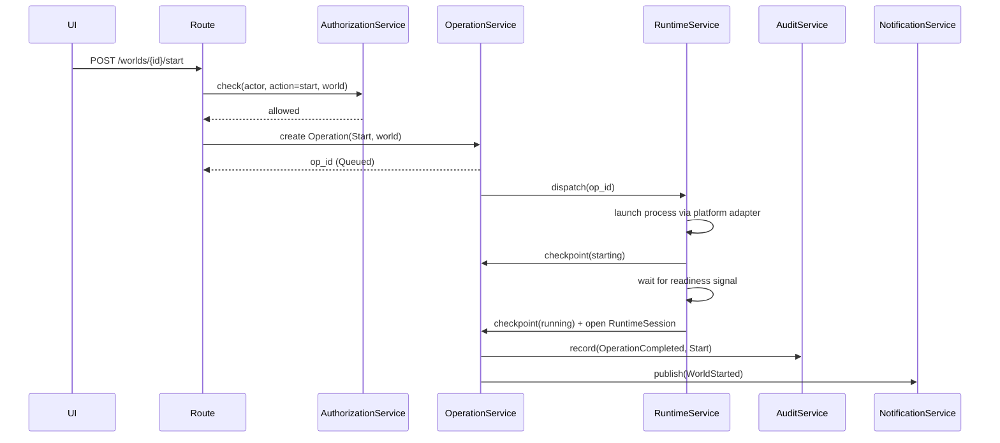

# Document 8: Application Services & Operation Flows

Purpose
- Turn Documents 6–7 into concrete service behavior: who does what, in what order, with what retry/timeout/cancellation rules.
- Concurrency and conflict rules: **Document 11 is the single authoritative source. §7 of the previous revision is superseded by it.**

1. Service Responsibilities & Boundaries

| Service | Owns | Does not | Tables |
|---|---|---|---|
| WorldService | World registry CRUD; template-based creation (`CreateWorld`); listing/detail; tombstoning (`DeleteWorld`); `RenameWorld` (lightweight `ConfigEdit` on `display_name` only — concurrent with Backup/Restore/Cleanup, Doc 11 §3.1). Enforces runtime-config rule (Doc 6 §4): `java_runtime_id`/`launch_args`/`port` edits rejected unless `off`; write immediate, effect at next boot (Doc 11 §5) | Live process or backup/restore/cleanup work — delegates to Runtime/Backup/Restore/Cleanup | `world_instances`, `world_settings`, `templates` (read), `java_runtimes` (read) |
| RuntimeService | Start/stop/kill via platform adapter; RuntimeSession open/close; per-session RCON credential rotation; health probing; crash detection; state resolution | Create/own the durable Operation — executes *under* one dispatched by OperationService/SchedulerService, reports checkpoints | `world_instances`, `runtime_sessions`, `secrets` (RCON only) |
| OperationService | Operation creation/status transitions/checkpoints; idempotency lookup; timeouts; cancellation (cancellable types). Clears `world_instances.current_operation_id` at any terminal status | Perform domain actions — the durable wrapper, not a worker | `operations` |
| BackupService | Capture (storage guard, pause autosave, flush/save, zip/snapshot, register artifact, resume autosave); RCON player notices; dispatch follow-on `Sync` after a successful capture when a SyncTarget resolves. Also **ManagerBackup** (`Backup`, `world_id = NULL` — manager DB/settings/templates/permissions) | Decide *when* to run (Scheduler/user); perform the sync itself | `backup_artifacts`, `operations` (checkpoints), `runtime_sessions` (read) |
| RestoreService | Restore workflow (validate artifact, stop if required, mandatory pre-restore backup, stage, archive old world, switch `server.properties`, restart if previously running); `restore_history` | Routine backups — delegates pre-restore to BackupService | `restore_history`, `backup_artifacts`, `world_instances`, `operations` |
| CleanupService | Retention evaluation (dry/wet) vs `cleanup_policies`; the *only* service allowed to issue a physical `DELETE FROM` (Doc 6 §0) | Touch Tier 1 tables | `backup_artifacts` (file+row removal), stale world dirs, aged-out soft-deleted Tier 2 rows |
| SyncService | Offsite transfers vs a SyncTarget; one `sync_records` row per job; **auto-retry transient failures with backoff** (network blip ≠ domain failure; source artifact immutable) | Choose the target (ConfigurationService owns `sync_targets`); manage credentials; do backups (dispatched after the artifact exists) | `sync_records`, `sync_attempts` (Tier 1: attempts = retry history; records = derived status), `sync_targets` (read), `backup_artifacts` (read), `secrets` (via sync adapter only) |
| SchedulerService | Evaluate due `schedules`; dispatch the Operation when due; detect/record missed runs as `missed_run_records` (never resolves/deletes them) | Perform the scheduled work itself | `schedules`, `missed_run_records` (create), `operations` (create) |
| AuthenticationService | Username+password login; `client_sessions`; retry throttling/lockout; step-up | Decide permissions — AuthorizationService's job | `users`, `secrets` (verify), `client_sessions`, `devices` (context) |
| AuthorizationService | Policy evaluation (actor, role, direct permission, world scope, safety state); three-role model; Superadmin-only permission delegation | Authenticate — assumes a valid non-expired session | `roles`, `role_assignments`, `permissions` (read-heavy) |
| NotificationService | Publish `notifications` (4 severities, Doc 6 §2.8); lazily create/update `notification_reads` per user; shell dropdown (Doc 5), critical/high first | Decide merit beyond the fixed trigger list (§9, Doc 2 §7.3); ever delete a `notifications` row | `notifications`, `notification_reads` |
| AuditService | Write `audit_records` (action, denial, suspicious event) with write-time actor/device snapshot | Update/delete — inserts only, corrections via `annotation_of` | `audit_records` |
| FileManagerService | Guarded browse/upload/download/rename/delete/move/copy within a world's files (Doc 2 §5.1). File deletion is a direct fs op with elevated confirmation + audit — not routed through CleanupService | DB row deletion model | World filesystem (via adapter), `audit_records` (write) |
| TemplateService / JavaRuntimeService | CRUD + soft-deprecation of `templates`/`java_runtimes`. `templates.category` is free-text (Doc 7 §2.6) — a new server type is a new Template row, never code, if the adapter launches generically | | `templates`, `java_runtimes` |
| ConfigurationService | Guarded `server.properties`; orchestrates `ConfigEdit` Operations for Schedule/CleanupPolicy/Role/Permission/SyncTarget edits + soft-deletes (never direct silent writes); RenameWorld; `world_settings`/`global_settings` edits incl. idle-countdown override | | `world_instances` (metadata only), `world_settings`, `global_settings`, `schedules`, `cleanup_policies`, `roles`, `permissions`, `role_assignments`, `sync_targets`, `templates` (write, logged) |
| MetricsService | Cadence rules (Doc 1 §1: paused when off+0 clients; 15s cache when on+0 clients; 1Hz broadcast when ≥1 client); snapshot caching for first paint | Persist anything | None (reads live state, broadcasts) |

- **Optimistic concurrency** (ConfigurationService): `version` on every multi-admin-editable table (`schedules`, `cleanup_policies`, `global_settings`, `world_settings`, `templates`, `roles`, `sync_targets`, `world_instances` metadata). Stale-`version` edits rejected with a conflict error, never silently applied. Table: Document 11 §4.
- Service↔entity mapping is implied by each row's **Tables** column (mirrors Doc 3 §5 subsystem map).

2. Command Flow Per Operation Type

Standard shape for all: authorize → validate preconditions → create Operation → queue → dispatch → execute with checkpoints → audit → notify → terminal status.

| Operation Type | Preconditions | Domain Service | Terminal Success State |
|---|---|---|---|
| CreateWorld | valid Template, non-conflicting port/addressing, authz passes | WorldService | new `world_instances` row, `state = off` |
| Start | world = `off`, storage guard passes, not in 10s cooldown | RuntimeService | `state = running`, new `runtime_sessions` row |
| Stop | world != `off`, password verified | RuntimeService | `state = off`, `runtime_sessions.ended_at` set |
| Kill | world = `running`/`stopping` (escalation), step-up + elevated confirmation | RuntimeService | same as Stop, `end_reason = forced_stop` |
| Backup | no backup/restore/cleanup in flight for this world, storage guard passes | BackupService | new `backup_artifacts` row, world returns to `pre_backup_state` |
| Restore | world = `off`, no backup/cleanup running, valid artifact | RestoreService | `restore_history` row, world back to `off` |
| Cleanup | no backup/restore running for the affected scope | CleanupService | summary in `operations.data_json`; any row/file removal performed |
| Sync | backup just completed, a SyncTarget resolves (override or global default) | SyncService | new `sync_records` row (`succeeded`), artifact mirrored |
| ConfigEdit | authz passes for the config category | ConfigurationService | updated row + `deleted_at`/revoked marker if applicable, always audited |
| CrashDetected | none (system-observed) | RuntimeService | `state = crashed`, actor_type = `system` |
| DeleteWorld | world = `off`, no in-flight op, step-up + elevated confirmation | WorldService | `deleted_at` set (tombstoned), files removed |

**"Elevated confirmation"** (defined once): (1) password step-up per Doc 2 §8.2 (re-entry even for an authenticated session) + (2) explicit scope-preview confirmation per Doc 2 §8.4. `Kill`/`DeleteWorld` require both; `Stop`/`Restore`'s existing password verification is the same concept.

3. Query Responsibilities

- World list/detail → WorldService (composes RuntimeService live state + BackupService last-backup summary); search/filter at query layer (Doc 7 §2.4 index).
- Live metrics → MetricsService. Operation history/status → OperationService. Backup/restore inventory → BackupService/RestoreService.
- Notifications (unread count, prioritized) → NotificationService, joined vs `notification_reads`, severity then recency.
- Audit/history → AuditService. Missed runs → SchedulerService. Device/user/role views → AuthenticationService/AuthorizationService.

4. Flow Documentation

4.1 Canonical flow — Start (all other operations share this shape)

4.2 Flow summaries (dispatch → … → terminal; each minus the authorize/audit/notify bookends from 4.1)

| Operation | Domain flow |
|---|---|
| Backup | storage guard → pause autosave (RCON) → capture/zip/snapshot → register `backup_artifacts` → resume autosave → dispatch follow-on Sync if target resolves → Completed (guard fail ⇒ `Failed`, no artifact) |
| Restore | validate artifact → mandatory pre-restore backup → stage files → archive old world → switch `server.properties` → write `restore_history` → Completed, or Failed[reverted] if corruption detected |
| Cleanup (wet) | evaluate candidates vs policy floors → apply blast-radius cap → DELETE files/rows (the only hard-delete path) → summary into `data_json` → Completed |
| Sync | resolve target (world override or global default) → create `sync_records` (pending) → per attempt: upload, insert immutable `sync_attempts` → derive `status` from latest attempt → Completed/Failed |
| CrashDetected | observed process exit → create system Operation → `state = crashed`, close RuntimeSession(`end_reason = crashed`) → audit + notify |
| CreateWorld / DeleteWorld / ConfigEdit / Kill | standard shape from §2; diagrams deferred (no new structural patterns) |

5. Scheduler Behavior

- Evaluate all enabled `schedules` on a fixed tick (candidate default 30s, matching `legacyImplementation.txt` cadence; exact interval is a tuning decision).
- Due schedule: check for a conflicting in-flight Operation for the scope (Document 11); clear → create + dispatch; not clear or tick missed → create a `missed_run_records` row — never silently catch up (Doc 1 §13).
- Missed runs are never auto-retried; they sit `pending` until an operator marks `resolved` (manual run) or `ignored`.

6. Retry, Timeout, and Cancellation Policy

| Operation Type | Auto-retry? | Timeout | Cancellable? |
|---|---|---|---|
| CreateWorld | No | Short — directory/registry setup | Only while `Queued`/`Validating` |
| Start | No (duplicate-guard + cooldown) | Configurable, default 120s for readiness | No — once Running, interrupt = Kill |
| Stop | No | 60s before escalating to Kill | No |
| Kill | No | Short — process-level | No |
| Backup | No (retry = new trigger) | Configurable per world size; no artifact until success ⇒ timeout ≡ failure | Only while `Queued`/`Validating` |
| Restore | No | Longer default (file I/O) | Only while `Queued`/`Validating` — once staging, must reach a terminal state (success or safely-reverted failure) |
| Cleanup | No | Configurable, scales with candidate set | Yes while `Queued`/`Validating` |
| Sync | **Yes — sole exception.** Exponential backoff (default 3 attempts) for transient failures; permanent failures (auth, target full) → `Failed` immediately | Per-attempt + outer job timeout, configurable | **Yes, even while `Running`** — sole exception. Aborting a transfer is safe: the local artifact is immutable |
| ConfigEdit | N/A — synchronous/fast | Short | No — applies or rejects at validation |
| CrashDetected | N/A — system observation | N/A | No |
| DeleteWorld | No | Configurable, scales with world size | Only while `Queued`/`Validating` |

- General rule: `Cancelled` only from `Queued`/`Validating`. Nothing is cancellable once `Running` — real-world side effects can't be naively unwound. Kill is the safe interrupt for a running world; in-flight Backup/Restore run to a terminal state.
- Sync is the deliberate exception to both rules (auto-retry, cancel-while-Running): a network transfer reads an immutable artifact already safe elsewhere; transfer failures and aborts carry no irreversibility.

7. Concurrency and Conflict Rules

- **Superseded by Document 11 — the authoritative source** for: lock taxonomy (world / global storage / cleanup scope / config version), the full mutual-exclusion matrix (incl. RenameWorld+Backup, runtime-config-edit-while-running), generalized optimistic concurrency, queue/reject/preempt.
- Still accurate: Backup > Restore > Cleanup priority (Doc 1 §14); Restore/Cleanup reject a second trigger while one is in flight; Backup queues (single-flight via idempotency key); Start ignores duplicates until `off`; Stop idempotent; `DeleteWorld` requires `off` and rejects if an op is in flight; storage guard is a global lock blocking Start/Backup for every world while tripped; Sync single-flight per artifact, independent of the Backup/Restore/Cleanup/Start/Stop matrix.

8. Failure Recovery (ties to Doc 7 §6)

- **Start** left `Validating`/`Running` past a restart with no matching process → `Failed`, `error_code = manager_restart_incomplete`, state `off`.
- **Backup** interrupted → `Failed`; no `backup_artifacts` row for a failed attempt (Doc 6 §2.5) — only the Operation's terminal state needs setting.
- **Restore** interrupted → no dedicated undo (Doc 1 §3); recovery = manually re-run Restore using the mandatory pre-restore backup. **Known, accepted product limitation** — not to be "fixed" into false transactionality.
- **Cleanup** interrupted → partial deletion possible; next evaluation recomputes fresh and continues — idempotent by construction.

9. Notification Pipeline

- Fixed triggers (Doc 2 §7.3): world started/stopped/crashed; backing up/restoring; sync failure; suspicious activity; unauthorized attempts; critical low storage; missed jobs.
- Each trigger → exactly one `notifications` row (Tier 1, permanent). `notification_reads` created lazily per user on first view — not fanned out upfront.
- Severity: critical = crash/unauthorized/critical-storage; high = backup/restore failed, sync failed terminal; normal = missed job, sync retry, suspicious activity; informational = started/stopped, backup/cleanup succeeded.

10. Audit Pipeline

- Every Operation's creation + every terminal transition → one `audit_records` row.
- Every `ConfigEdit` → audit row with before/after diff in `payload`.
- Every login attempt (success/failure) and authz denial → audit row with write-time `device_id_snapshot`/`device_name_snapshot` (Doc 6 §1.1).
- AuditService never updates/deletes; corrections use `annotation_of`.

11. Checklist Status (Document 9 "Document 8 Expansion")

- [x] Services (§1, 16 incl. SyncService), boundaries, command flows (§2), query ownership (§3)
- [x] Scheduler (§5), retry/timeout/cancellation (§6), failure recovery (§8), notifications (§9), audit (§10)
- [x] Concurrency — Document 11 authoritative (§7)
- [~] Flow docs (§4): Start diagram + summaries for Backup/Restore/Cleanup/Sync/CrashDetected; full diagrams for CreateWorld/DeleteWorld/ConfigEdit/Kill deferred
- Deferred (polishing, non-blocking): exact numeric timeout/retry/tick values; the four deferred diagrams.
